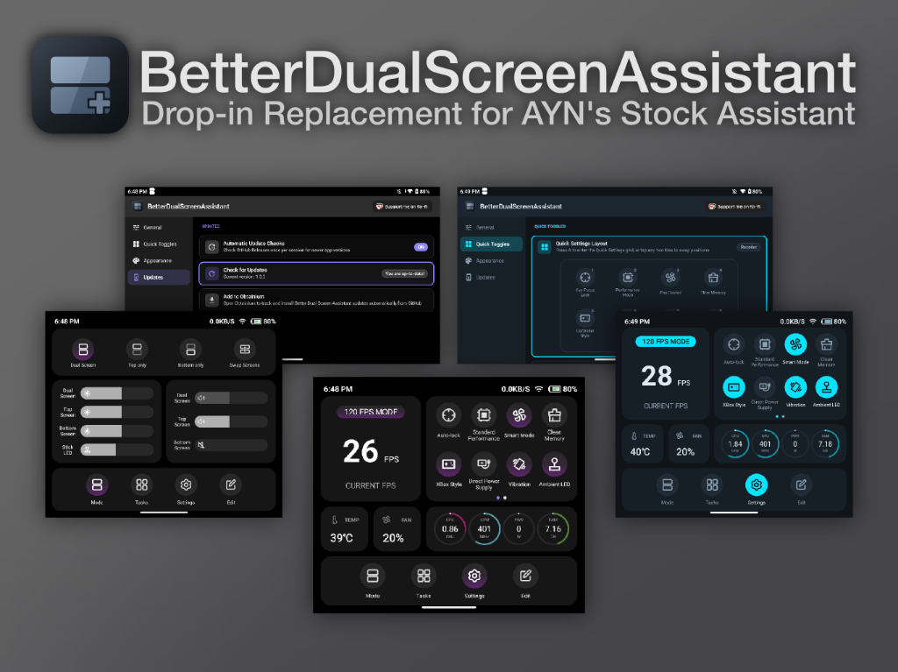

<p align="center">
  
</p>

# Better Dual Screen Assistant

**Better Dual Screen Assistant** (`com.stormpanda.betterdualscreenassistant`) is a user-installable drop-in replacement and feature-packed upgrade for the built-in system `DualScreenAssistant` (`com.odin.dualscreen.assistant` / `com.retroidpocket.dualscreen.assistant`) on the **AYN Thor** (`kalama` / Snapdragon 8 Gen 2, Android 13) and **Retroid Pocket Duo** (`sun` / `CQ7790S`, Android 16) dual-screen handhelds.

It preserves 1:1 visual and functional parity with each device's stock assistant while adding cross-device **AYN Smooth** & **Retroid Pixel** UI looks across all themes, a gamepad-first **Top-Screen Companion Settings App**, **24 customizable & reorderable Quick Setting tiles** across three categories, **Hardware-Accelerated Screen & Audio Recording**, **Screen Task Swapping**, **Stick LED Brightness control**, **Megingiard Theme Palettes & Live Sync**, **Monet OS Theme Injection**, and a **sub-millisecond `UID 0` Binder Helper Daemon** with persistent service supervision and automatic uninstall recovery.

<p>
  <a href="https://apps.obtainium.imranr.dev/redirect?r=obtainium://add/https://github.com/stormpanda/better-dual-screen-assistant">
    
  </a>
</p>

---

## Documentation Index

Full functional and technical documentation is available in [`docs/`](docs/):

| Document | Scope |
| :--- | :--- |
| **[Security & Privacy Overview](docs/SECURITY.md)** | Executive summary, side-by-side security & privacy comparison against the stock `DualScreenAssistant`, explanation of `PServerBinder` & `PrivilegedHelperMain`, permission breakdown, and automatic uninstall recovery guarantees. |
| **[Functional Specification](docs/FUNCTIONAL_SPECIFICATION.md)** | Complete user-facing guide covering the physical assistant button state machine, bottom-screen overlay tabs (**Mode** & **Settings**), all **24 Quick Setting tiles**, modal dialogs, live hardware telemetry, and the top-screen **Companion Settings App** (`MainActivity`). |
| **[Technical Architecture](docs/TECHNICAL_ARCHITECTURE.md)** | Deep dive into the 3-tier privileged execution model (`PrivilegedBridge` -> `PrivilegedHelperMain` `UID 0` daemon -> `PServerBinder`), ephemeral stock `DualScreenAssistant` suppression, persistent service supervision & uninstall recovery watchdog, and multi-display windowing invariants across AYN Thor (`displayId = 4`) & Retroid Pocket Duo (`displayId = 2`). |
| **[System Integration & Hardware Reference](docs/SYSTEM_INTEGRATION_REFERENCE.md)** | Complete reference tables for all `Settings.System`/`Global`/`Secure` keys, `SharedPreferences` (`better_dsa_prefs`), system properties (`sys.temp.disabled.touch`, `sys.light.curr.is.show`), vendor Binder services (`IFanControlProvider`, `IOverviewProxy`, `IMappingService`), sysfs telemetry paths, and `FabricatedOverlay` Monet keys. |
| **[AYN Thor Hardware Reference](docs/devices/AYN_THOR.md)** | Complete hardware, AMOLED multi-display (`displayId = 0` & `4`), DDIC TE clock ratio, OLED blanking, thermal/fan/RGB sysfs, Binder IPC, and `DeviceProfile.AYN_THOR` specification. |
| **[Retroid Pocket Duo Hardware Reference](docs/devices/RETROID_POCKET_DUO.md)** | Complete hardware, Android 16 (`SDK 36`), `4:3` secondary display (`displayId = 2`), `bl_power` backlight blanking, `CQ7790S` thermal/sysfs, `ILauncherProxy` / `com.rp.*` IPC, and `DeviceProfile.RETROID_POCKET_DUO` specification. |
| **[Device Hardware Profile Template](docs/devices/DEVICE_PROFILE_TEMPLATE.md)** | Standardized 10-section hardware & firmware documentation template (plus read-only ADB discovery commands) for onboarding future dual-screen handhelds. |
| **[UI Architecture, Custom Widgets & Theming](docs/UI_AND_THEMING.md)** | Specification of the canonical `720dp` `OverlayViewport` + `TccLookSpec` (`AYN Smooth` & `Retroid Pixel`), custom non-Material canvas widgets (`HorizontalSlidingBar`, `HardwareRingGauge`, `FrameRatePanelCard`, `BatteryIconCanvas`), all 12 `AppThemeOption` palettes, and the embedded `com.stormpanda.megingiard` gamepad design system. |
| **[Build, Release & Developer Guide](docs/BUILD_AND_RELEASE.md)** | Developer instructions for keystore signing (`local.properties`), debug builds (`scripts/debug.sh`), release git-flow automation (`scripts/release.sh`), SHA-256 verification (`scripts/generate_checksum.sh`), and ADB inspection commands. |
| **[Contributing Guidelines](CONTRIBUTING.md)** | Architectural rules, multi-display & privileged hardware invariants, coding conventions, and licensing compliance instructions for contributors. |
| **[Agent Guidelines](AGENTS.md)** | Essential context, architectural invariants, hardware quirks, and workflow rules for AI coding agents working on this project. |

---

## Key Features

### 1. Bottom-Screen Assistant Overlay (`displayId = 4` `1240 × 1080` on AYN Thor • `displayId = 2` `1280 × 960` on Retroid Pocket Duo)
- **Mode Tab (`Tab 0`)**:
  - **Screen Mode Control**: Switch between **Dual-screen display** (`0`), **Only top screen** (`1`), and **Only bottom screen** (`2`), plus a one-tap **Swap Screens** button that swaps the top visible app tasks between the Top and Bottom screens.
  - **Brightness Sliders**: Linked **Dual Screen**, **Top Screen**, **Bottom Screen** (with zero-lag hardware `setTemporaryBrightness` during drag and external SystemUI slider tracking), plus an optional **Stick LED** brightness slider (`0%–100%` on AYN Thor).
  - **Volume Sliders**: Linked **Dual Screen**, **Top Screen** (`STREAM_MUSIC`), and **Bottom Screen** (`secondary_screen_volume_level`).
- **Settings Tab (`Tab 1`)**:
  - **Frame Rate Panel**: One-tap **`60 HZ MODE` / `120 HZ MODE`** toggle paired with a live native-canvas **Game / `SurfaceFlinger` FPS readout**.
  - **24 Customizable Quick Setting Tiles** in a paged `2 × 4` grid (swipeable by touch or **`L1` / `R1`** shoulder buttons):
    - **Stock Vendor Toggles (Up to 10 — Enabled by default)**: *Focus Lock*, *Performance Mode*, *Fan Control* (Off/Quiet/Smart/Sport/Custom `35%–100%`), *Clear Memory*, *Controller Style* (Disconnect/Xbox/Odin or Retro), *Charging Separation*, *Vibration*, *Ambient Light* (AYN Thor), *Force Landscape*, and *Theme Mode*.
    - **Android System Toggles (4 — Optional)**: *Wi-Fi*, *Bluetooth*, *Do Not Disturb*, and *Airplane Mode*.
    - **Tools (Up to 10 — Optional)**: *Bottom Touch Lock*, *Screenshot* (Top / Bottom / Both screens saved to `/sdcard/Pictures/Screenshots`), *Screen Record* (Top / Bottom / Both screens + Internal Audio & Mic saved to `/sdcard/Movies/ScreenRecordings`), *L2/R2 Trigger Mode* (Analog / Digital / Both), *80% Charge Limit*, *Virtual Mouse*, *Key Mapper Overlay*, *Keep Screen On*, *Double-Tap HOME* (AYN Thor), and *Clear All Tasks*.
  - **Live Hardware Telemetry Panel**: Real-time **SoC Temperature** (with dynamic thermal tinting), **Fan Speed %** (`IFanControlProvider`), and 4 animated `270°` circular ring gauges for **CPU Frequency** (hardware max or active performance-mode scaling limit), **GPU Frequency** (`kgsl-3d0`), **Battery Power Draw** (`-20W..+25W`), and **RAM Usage**.
- **Top Status Bar & Bottom Navigation Bar**:
  - Status bar with live clock (tap to clean memory), Bluetooth indicator, live network RX speed (`KB/S` / `MB/S`), Wi-Fi signal bars, and custom battery icon with charging bolt.
  - Bottom navigation pill with **Mode**, **Task** (opens bottom-screen Recents via `IOverviewProxy` / `ILauncherProxy`), **Settings**, and **Edit** (launches the Companion App on the Top Screen).

### 2. Top-Screen Companion Settings App (`MainActivity` on `displayId = 0`)
- **Gamepad-First Two-Pane UI**: Navigate with **D-Pad / Left Stick**, switch categories with **`L1` / `R1`**, adjust sliders with **`L2` fine-step modifier**, and preview every change live on the bottom screen (`displayId = 4` / `2`).
- **Visual Quick Toggles Reordering**: Interactive `2 × 4` paged layout preview supporting both touch tap-to-move and gamepad grab-and-move (`A` to grab, D-Pad/`L1`/`R1` to move in real time, `B` to drop), plus categorized toggle visibility management.
- **Rich Theming & OS Monet Injection**:
  - Choose between **Stock** (`Follow System`, `Light`, `Dark`), **8 Built-in Custom Palettes** (`Dark`, `Dark OLED`, `Norse Forest`, `Mjölnir Steel`, `Valhalla Sunset`, `Aurora Borealis`, `Retro Phosphor`, `Royal Asgard`) with **13 Accent Presets** and a **Custom HSV Color Picker**, or **Sync with Megingiard** (silently revealed when Megingiard is installed on the device), paired orthogonally with either **AYN Smooth** or **Retroid Pixel** UI looks.
  - **Inject Theme Colors into OS**: Generates a 221-color Android 13–16 Monet `FabricatedOverlay` set to theme Android SystemUI, Quick Settings, Notifications, and Material You apps system-wide.
- **Live System Diagnostics**: Real-time status indicators and one-tap reconnection for `PrivilegedHelperMain (UID 0)`, `PServerBinder`, Stock `DualScreenAssistant` suppression state, and (when installed) the Megingiard Theme Provider.

### 3. Safe Ephemeral Stock Suppression & Automatic Uninstall Recovery
- Freezes the persistent stock `com.odin.dualscreen.assistant` / `com.retroidpocket.dualscreen.assistant` in RAM (`SIGSTOP`) without leaving its package or `TccServices` disabled on disk.
- While active, `PrivilegedHelperMain` (`UID 0`) supervises and immediately respawns `AssistantForegroundService` across task clears, RAM cleaners, or `force-stop`. If **Better Dual Screen Assistant** is ever **uninstalled**, **disabled (`pm disable`)**, or **opted out of *Replace Stock Assistant***, the watchdog automatically unblanks both screens (including kernel `bl_power` on Retroid Pocket Duo), restores display brightness and touch (`sys.temp.disabled.touch = "0,0"`), removes any injected OS theme overlay, and wakes/restarts the stock `DualScreenAssistant`.

---

## Quick Start (Build & Install)

Ensure your AYN Thor or Retroid Pocket Duo is connected via USB debugging (`adb devices`):

```bash
# Build and install the Debug APK in one step:
./scripts/debug.sh build-install

# Or build and install the minified Release APK:
./scripts/release.sh build-install

# Start the foreground service immediately via ADB:
adb shell am start-foreground-service \
  -n com.stormpanda.betterdualscreenassistant/.service.AssistantForegroundService
```

See [`docs/BUILD_AND_RELEASE.md`](docs/BUILD_AND_RELEASE.md) for keystore setup, release branch automation, and troubleshooting commands.

---

## License

Better Dual Screen Assistant is a proprietary, source-available project. It is licensed under the custom **Better Dual Screen Assistant Source-Available License (Version 1.0)**.

- **Source Code & Binaries:** You are permitted to view the source code, compile it, and run the application solely for your own **personal, non-commercial use**.
- **Prohibitions:** Any commercial exploitation, redistribution of modified source/binaries, and pre-installation or bundling on commercial hardware/devices without prior written consent are strictly prohibited.
- **Open Source Transition Commitment:** The Copyright Holder commits to transitioning the entire codebase to a fully permissive, OSI-approved open-source license (such as MIT or Apache 2.0) with full redistribution rights in the event that active development is permanently discontinued without a successor.

For the full terms and conditions, please refer to the [LICENSE](LICENSE) file at the root of the repository, [THIRD_PARTY_NOTICES.md](THIRD_PARTY_NOTICES.md) for bundled open-source font and library attributions, and [CONTRIBUTING.md](CONTRIBUTING.md) before submitting contributions.
