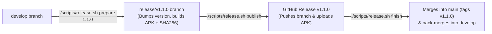

# Build, Release & Developer Guide

This document explains how to build, sign, install, debug, and publish **Better Dual Screen Assistant** (`com.stormpanda.betterdualscreenassistant`).

---

## Table of Contents

1. [Toolchain & SDK Requirements](#1-toolchain--sdk-requirements)
2. [Keystore & APK Signing Configuration](#2-keystore--apk-signing-configuration)
3. [Debug Workflow (`scripts/debug.sh`)](#3-debug-workflow-scriptsdebugsh)
4. [Release Workflow & Git-Flow Automation (`scripts/release.sh`)](#4-release-workflow--git-flow-automation-scriptsreleasesh)
   - [4.1 Building & Installing Release APKs](#41-building--installing-release-apks)
   - [4.2 Full Release Lifecycle (`prepare` -> `publish` -> `finish`)](#42-full-release-lifecycle-prepare---publish---finish)
   - [4.3 Version Bumping (`bump`) & Checksum Generation](#43-version-bumping-bump--checksum-generation)
5. [ADB Service Management & Troubleshooting Commands](#5-adb-service-management--troubleshooting-commands)

---

## 1. Toolchain & SDK Requirements

Defined in [`app/build.gradle.kts`](file:///Users/maikthomalla/Development/better-dual-screen-assistant/app/build.gradle.kts) and [`gradle/libs.versions.toml`](file:///Users/maikthomalla/Development/better-dual-screen-assistant/gradle/libs.versions.toml):

| Component | Version / Value |
| :--- | :--- |
| **Application ID** | `com.stormpanda.betterdualscreenassistant` |
| **Android Gradle Plugin (AGP)** | `8.13.2` |
| **Kotlin** | `2.2.21` (Compose Compiler Plugin) |
| **JDK / JVM Target** | Java `17` (`JvmTarget.JVM_17`) |
| **Compile SDK / Target SDK** | `35` (Android 15) |
| **Minimum SDK** | `33` (Android 13 — AYN Thor firmware baseline) |
| **Compose BOM** | `2024.10.01` |
| **HiddenApiBypass** | `org.lsposed.hiddenapibypass:hiddenapibypass:4.3` |

---

## 2. Keystore & APK Signing Configuration

Both `debug` and `release` build types in [`app/build.gradle.kts`](file:///Users/maikthomalla/Development/better-dual-screen-assistant/app/build.gradle.kts#L28-L55) automatically sign APKs using your custom keystore when configured in `local.properties` (falling back to the default Android debug keystore if omitted). Using a consistent signing certificate across `debug` and `release` builds allows seamless over-the-air switching (`adb install -r`) without uninstalling.

Add the following properties to `local.properties` in the repository root (which is git-ignored):

```properties
sdk.dir=/Users/<username>/Library/Android/sdk

# Primary keystore properties for Better Dual Screen Assistant:
bdsa.keystore.file=/absolute/path/to/your-release-key.jks
bdsa.keystore.password=YOUR_STORE_PASSWORD
bdsa.key.alias=YOUR_KEY_ALIAS
bdsa.key.password=YOUR_KEY_PASSWORD
```

*(Note: `app/build.gradle.kts` also supports `megingiard.keystore.file`, `megingiard.keystore.password`, `megingiard.key.alias`, and `megingiard.key.password` as fallback property names if you share the same signing certificate across Stormpanda apps).*

---

## 3. Debug Workflow (`scripts/debug.sh`)

[`scripts/debug.sh`](file:///Users/maikthomalla/Development/better-dual-screen-assistant/scripts/debug.sh) compiles the debug APK, copies it to `app/debug/BetterDualScreenAssistant-v<version>-debug.apk`, generates a matching `.sha256` file, and installs it onto a connected AYN Thor over ADB:

```bash
# 1. Build debug APK + SHA-256 checksum in app/debug/
./scripts/debug.sh build

# 2. Install existing debug APK from app/debug/ onto connected AYN Thor
./scripts/debug.sh install

# 3. Build and install in one step
./scripts/debug.sh build-install
```

**Output Artifacts (`app/debug/`)**:
- `app/debug/BetterDualScreenAssistant-v<versionName>-debug.apk`
- `app/debug/BetterDualScreenAssistant-v<versionName>-debug.apk.sha256`

---

## 4. Release Workflow & Git-Flow Automation (`scripts/release.sh`)

[`scripts/release.sh`](file:///Users/maikthomalla/Development/better-dual-screen-assistant/scripts/release.sh) manages release APK builds (`isMinifyEnabled = true`, `isShrinkResources = true`), GitHub Releases (`gh release`), and `main`/`develop` branch synchronization.

### 4.1 Building & Installing Release APKs

```bash
# Build release APK + SHA-256 checksum in app/release/
./scripts/release.sh build

# Install existing release APK onto connected AYN Thor
./scripts/release.sh install

# Build and install release APK in one step
./scripts/release.sh build-install
```

**Output Artifacts (`app/release/`)**:
- `app/release/BetterDualScreenAssistant-v<versionName>.apk`
- `app/release/BetterDualScreenAssistant-v<versionName>.apk.sha256`

### 4.2 Full Release Lifecycle (`prepare` -> `publish` -> `finish`)



1. **Prepare a Release Branch (`prepare`)**:
   ```bash
   ./scripts/release.sh prepare 1.1.0
   ```
   - Verifies clean working tree on `develop`.
   - Creates branch `release/v1.1.0`.
   - Increments `versionCode` and sets `versionName = "1.1.0"` in `app/build.gradle.kts`.
   - Builds the signed release APK (`app/release/BetterDualScreenAssistant-v1.1.0.apk`) and `.sha256` checksum.
   - Commits the version bump and release artifacts (`chore(release): prepare release v1.1.0`).
2. **Publish to GitHub Releases (`publish`)**:
   ```bash
   ./scripts/release.sh publish
   ```
   - Pushes `release/v1.1.0` to `origin` and creates/updates the GitHub release via `gh release create v1.1.0`, attaching the `.apk` and `.apk.sha256` files.
3. **Finish Release (`finish`)**:
   ```bash
   ./scripts/release.sh finish
   ```
   - Merges `release/v1.1.0` into `main` (`--no-ff`), tags `v1.1.0`, merges `release/v1.1.0` back into `develop`, pushes `main`, `develop`, and tags to `origin`, and deletes the temporary `release/v1.1.0` branch.

### 4.3 Version Bumping (`bump`) & Checksum Generation

- **Standalone Version Bump**:
  ```bash
  ./scripts/release.sh bump 1.1.0        # Auto-increments versionCode by +1
  ./scripts/release.sh bump 1.1.0 5      # Explicitly sets versionCode = 5
  ```
- **Manual Checksum Generation**:
  ```bash
  ./scripts/generate_checksum.sh app/release/BetterDualScreenAssistant-v1.0.0.apk
  ```

---

## 5. ADB Service Management & Troubleshooting Commands

### Start or Control the Assistant Foreground Service

```bash
# Start AssistantForegroundService
adb shell am start-foreground-service \
  -n com.stormpanda.betterdualscreenassistant/.service.AssistantForegroundService

# Show the bottom-screen overlay via intent
adb shell am start-foreground-service \
  -n com.stormpanda.betterdualscreenassistant/.service.AssistantForegroundService \
  -a com.stormpanda.betterdualscreenassistant.ACTION_SHOW_OVERLAY

# Hide the bottom-screen overlay via intent
adb shell am start-foreground-service \
  -n com.stormpanda.betterdualscreenassistant/.service.AssistantForegroundService \
  -a com.stormpanda.betterdualscreenassistant.ACTION_HIDE_OVERLAY

# Toggle the bottom-screen overlay via intent
adb shell am start-foreground-service \
  -n com.stormpanda.betterdualscreenassistant/.service.AssistantForegroundService \
  -a com.stormpanda.betterdualscreenassistant.ACTION_TOGGLE_OVERLAY
```

### Launch Companion Settings on Top Display (`displayId = 0`)

```bash
adb shell am start --display 0 \
  -n com.stormpanda.betterdualscreenassistant/.MainActivity
```

### Inspect Display IDs & Capture Display Screenshots

Physical display IDs used by `screencap -d` are assigned per boot by `SurfaceFlinger`:
- `port=131` = **Top Screen** (`1920 × 1080`)
- `port=132` = **Bottom Screen** (`1240 × 1080`)

```bash
# Query current physical display IDs
adb shell dumpsys SurfaceFlinger --display-id

# Capture bottom screen screenshot (replace <phys_id> with ID for port=132)
adb exec-out screencap -p -d <phys_id> > /tmp/bottom_screen.png
```

### Inspect Logs & Privileged Daemon Status

```bash
# Tail application, privileged bridge, and root helper logs
adb logcat -s BetterDSAApp:D AssistantFgService:D ScreenOverlayManager:D \
  SystemSettingsRepo:D PrivilegedBridge:D PrivilegedHelperMain:D PServerClient:D

# Verify running UID 0 PrivilegedHelperMain process
adb shell ps -A | grep -E "betterdualscreenassistant|app_process"

# Verify stock DualScreenAssistant process state ('T' = stopped/suppressed in RAM)
adb shell ps -A -o PID,STAT,NAME | grep com.odin.dualscreen.assistant
```
