# Build, Release & Developer Guide

This document explains how to build, sign, install, debug, and publish **Better Dual Screen Assistant** (`com.stormpanda.betterdualscreenassistant`).

---

## Table of Contents

1. [Toolchain & SDK Requirements](#1-toolchain--sdk-requirements)
2. [Keystore & APK Signing Configuration](#2-keystore--apk-signing-configuration)
3. [Debug Workflow (`scripts/debug.sh`)](#3-debug-workflow-scriptsdebugsh)
4. [Release Workflow & Git-Flow Automation (`scripts/release.sh`)](#4-release-workflow--git-flow-automation-scriptsreleasesh)
   - [4.1 Building & Installing Release APKs](#41-building--installing-release-apks)
   - [4.2 Full Release Lifecycle (`prepare` -> `publish` -> `finish`)](#42-full-release-lifecycle-prepare---publish---finish)
   - [4.3 Version Bumping (`bump`) & Checksum Generation](#43-version-bumping-bump--checksum-generation)
5. [ADB Service Management & Troubleshooting Commands](#5-adb-service-management--troubleshooting-commands)

---

## 1. Toolchain & SDK Requirements

Defined in [`app/build.gradle.kts`](file:///Users/maikthomalla/Development/better-dual-screen-assistant/app/build.gradle.kts) and [`gradle/libs.versions.toml`](file:///Users/maikthomalla/Development/better-dual-screen-assistant/gradle/libs.versions.toml):

| Component | Version / Value |
| :--- | :--- |
| **Application ID** | `com.stormpanda.betterdualscreenassistant` |
| **Android Gradle Plugin (AGP)** | `8.13.2` |
| **Kotlin** | `2.2.21` (Compose Compiler Plugin) |
| **JDK / JVM Target** | Java `17` (`JvmTarget.JVM_17`) |
| **Compile SDK / Target SDK** | `35` (Android 15) |
| **Minimum SDK** | `33` (Android 13 — AYN Thor firmware baseline) |
| **Compose BOM** | `2024.10.01` |
| **HiddenApiBypass** | `org.lsposed.hiddenapibypass:hiddenapibypass:4.3` |

---

## 2. Keystore & APK Signing Configuration

Both `debug` and `release` build types in [`app/build.gradle.kts`](file:///Users/maikthomalla/Development/better-dual-screen-assistant/app/build.gradle.kts#L28-L55) automatically sign APKs using your custom keystore when configured in `local.properties` (falling back to the default Android debug keystore if omitted). Using a consistent signing certificate across `debug` and `release` builds allows seamless over-the-air switching (`adb install -r`) without uninstalling.

Add the following properties to `local.properties` in the repository root (which is git-ignored):

```properties
sdk.dir=/Users/<username>/Library/Android/sdk

# Primary keystore properties for Better Dual Screen Assistant:
bdsa.keystore.file=/absolute/path/to/your-release-key.jks
bdsa.keystore.password=YOUR_STORE_PASSWORD
bdsa.keystore.alias=YOUR_KEY_ALIAS
bdsa.keystore.key.password=YOUR_KEY_PASSWORD
```

*(Note: `app/build.gradle.kts` also supports `megingiard.keystore.file`, `megingiard.keystore.password`, `megingiard.keystore.alias`, and `megingiard.keystore.key.password` as fallback property names if you share the same signing certificate across Stormpanda apps).*

---

## 3. Debug Workflow (`scripts/debug.sh`)

[`scripts/debug.sh`](file:///Users/maikthomalla/Development/better-dual-screen-assistant/scripts/debug.sh) compiles the debug APK, copies it to `app/debug/BetterDualScreenAssistant-v<version>-debug.apk`, and installs it onto a connected AYN Thor over ADB:

```bash
# 1. Build debug APK in app/debug/
./scripts/debug.sh build

# 2. Install existing debug APK from app/debug/ onto connected AYN Thor
./scripts/debug.sh install

# 3. Build and install in one step
./scripts/debug.sh build-install
```

**Output Artifact (`app/debug/`)**:
- `app/debug/BetterDualScreenAssistant-v<versionName>-debug.apk`

---

## 4. Release Workflow & Git-Flow Automation (`scripts/release.sh`)

[`scripts/release.sh`](file:///Users/maikthomalla/Development/better-dual-screen-assistant/scripts/release.sh) manages release branches (`release/X.Y.Z`), signed release APK builds, SHA-256 checksums, GitHub Release drafts (`gh release`), and local merge-back/version bumping on `main`. This workflow is also automated via the agent skills [`bdsa-release`](file:///Users/maikthomalla/Development/better-dual-screen-assistant/.agents/skills/bdsa-release/SKILL.md) and [`bdsa-release-changelog`](file:///Users/maikthomalla/Development/better-dual-screen-assistant/.agents/skills/bdsa-release-changelog/SKILL.md).

### 4.1 Building & Installing Release APKs

```bash
# Build signed release APK + SHA-256 checksum in app/release/
./scripts/release.sh build

# Copy to /sdcard/Download and install release APK onto connected AYN Thor
./scripts/release.sh install

# Build and install release APK in one step
./scripts/release.sh build-install
```

**Output Artifacts (`app/release/`)**:
- `app/release/BetterDualScreenAssistant-v<versionName>.apk`
- `app/release/BetterDualScreenAssistant-v<versionName>-checksum-sha256.txt`

### 4.2 Full Release Lifecycle (`prepare` -> `build` -> `publish` -> `finish` -> `bump`)

```mermaid
flowchart LR
    Main["main branch (or release/*)"] -->|"./scripts/release.sh prepare"| Rel["release/X.Y.Z branch\n(Sets versionName, tags X.Y.Z, pushes branch & tag)"]
    Rel -->|"./scripts/release.sh build"| Build["Signed APK + SHA-256\nin app/release/"]
    Build -->|"./scripts/release.sh publish .tmp/release_changelog.md"| GH["GitHub Release Draft\nBetterDualScreenAssistant-vX.Y.Z"]
    GH -->|"./scripts/release.sh finish"| Merge["Merges release/X.Y.Z\ninto main locally"]
    Merge -->|"./scripts/release.sh bump"| Bump["Increments versionCode &\nsets next -SNAPSHOT on main"]
```



1. **Prepare a Release Branch (`prepare`)**:
   ```bash
   ./scripts/release.sh prepare
   ```
   - Verifies clean tracked working tree on `main` (standard release) or `release/*` (hotfix release).
   - Determines target release version (strips `-SNAPSHOT` on `main`, or increments patch / strips `-SNAPSHOT` on `release/*`).
   - Creates/switches to `release/<version>`, sets `versionName = "<version>"` in `app/build.gradle.kts`, commits (`chore(release): set version name to <version> for release`), creates git tag `<version>`, and pushes both branch and tag to `origin`.
2. **Build Signed Release APK & Checksum (`build`)**:
   ```bash
   ./scripts/release.sh build
   ```
   - Runs `./gradlew :app:assembleRelease`, copies the signed APK to `app/release/BetterDualScreenAssistant-v<version>.apk`, and runs `scripts/generate_checksum.sh` to create `app/release/BetterDualScreenAssistant-v<version>-checksum-sha256.txt`.
3. **Publish Draft to GitHub Releases (`publish`)**:
   ```bash
   ./scripts/release.sh publish .tmp/release_changelog.md
   ```
   - Creates a **draft** GitHub release (`BetterDualScreenAssistant-v<version>`) using `gh release create <version> --draft --notes-file <changelog-file>`, attaching the `.apk` and `-checksum-sha256.txt` artifacts.
4. **Finish Release (`finish`)**:
   ```bash
   ./scripts/release.sh finish
   ```
   - Switches to `main` and merges `release/<version>` into `main` locally (`--no-ff`), automatically resolving `app/build.gradle.kts` conflicts in favor of `main`. Does **not** auto-push `main`.
5. **Bump Development Version (`bump`)**:
   ```bash
   ./scripts/release.sh bump
   ```
   - Increments `versionCode` by `+1` and updates `versionName` to the next development snapshot (`X.(Y+1).0-SNAPSHOT` on `main`, or `X.Y.(Z+1)-SNAPSHOT` on `release/*`).

### 4.3 Manual Checksum Generation

- **Generate SHA-256 Checksum for `app/release/*.apk`**:
  ```bash
  ./scripts/generate_checksum.sh
  ```

---

## 5. ADB Service Management & Troubleshooting Commands

### Start or Control the Assistant Foreground Service

```bash
# Start AssistantForegroundService
adb shell am start-foreground-service \
  -n com.stormpanda.betterdualscreenassistant/.service.AssistantForegroundService

# Show the bottom-screen overlay via intent
adb shell am start-foreground-service \
  -n com.stormpanda.betterdualscreenassistant/.service.AssistantForegroundService \
  -a com.stormpanda.betterdualscreenassistant.ACTION_SHOW_OVERLAY

# Hide the bottom-screen overlay via intent
adb shell am start-foreground-service \
  -n com.stormpanda.betterdualscreenassistant/.service.AssistantForegroundService \
  -a com.stormpanda.betterdualscreenassistant.ACTION_HIDE_OVERLAY

# Toggle the bottom-screen overlay via intent
adb shell am start-foreground-service \
  -n com.stormpanda.betterdualscreenassistant/.service.AssistantForegroundService \
  -a com.stormpanda.betterdualscreenassistant.ACTION_TOGGLE_OVERLAY
```

### Launch Companion Settings on Top Display (`displayId = 0`)

```bash
adb shell am start --display 0 \
  -n com.stormpanda.betterdualscreenassistant/.MainActivity
```

### Inspect Display IDs & Capture Display Screenshots

Physical display IDs used by `screencap -d` are assigned per boot by `SurfaceFlinger`:
- `port=131` = **Top Screen** (`1920 × 1080`)
- `port=132` = **Bottom Screen** (`1240 × 1080`)

```bash
# Query current physical display IDs
adb shell dumpsys SurfaceFlinger --display-id

# Capture bottom screen screenshot (replace <phys_id> with ID for port=132)
adb exec-out screencap -p -d <phys_id> > /tmp/bottom_screen.png
```

### Inspect Logs & Privileged Daemon Status

```bash
# Tail application, privileged bridge, and root helper logs
adb logcat -s BetterDSAApp:D AssistantFgService:D ScreenOverlayManager:D \
  SystemSettingsRepo:D PrivilegedBridge:D PrivilegedHelperMain:D PServerClient:D

# Verify running UID 0 PrivilegedHelperMain process
adb shell ps -A | grep -E "betterdualscreenassistant|app_process"

# Verify stock DualScreenAssistant process state ('T' = stopped/suppressed in RAM)
adb shell ps -A -o PID,STAT,NAME | grep com.odin.dualscreen.assistant
```
