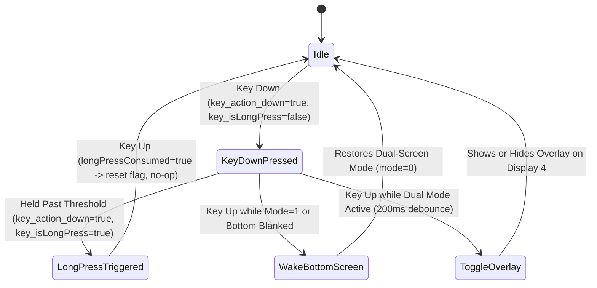

# Functional Specification

This document provides a complete functional reference for **Better Dual Screen Assistant** (`com.stormpanda.betterdualscreenassistant`) on the **AYN Thor** dual-screen handheld. It covers every user-facing feature, hardware button interaction, bottom-screen overlay control, quick setting tile, modal dialog, and top-screen companion configuration screen.

---

## Table of Contents

1. [Overview & Dual-Screen Surfaces](#1-overview--dual-screen-surfaces)
2. [Physical Hardware Button Workflows](#2-physical-hardware-button-workflows)
3. [Bottom-Screen Assistant Overlay (`displayId = 4`)](#3-bottom-screen-assistant-overlay-displayid--4)
   - [3.1 Top Status Bar](#31-top-status-bar)
   - [3.2 Mode Tab (`Tab 0`)](#32-mode-tab-tab-0)
   - [3.3 Settings Tab (`Tab 1`)](#33-settings-tab-tab-1)
   - [3.4 Quick Setting Tiles Reference (22 Tiles)](#34-quick-setting-tiles-reference-22-tiles)
   - [3.5 Modal Configuration Dialogs](#35-modal-configuration-dialogs)
   - [3.6 Live Hardware Telemetry Panel](#36-live-hardware-telemetry-panel)
   - [3.7 Bottom Navigation Bar](#37-bottom-navigation-bar)
4. [Top-Screen Companion Settings App (`MainActivity`)](#4-top-screen-companion-settings-app-mainactivity)
   - [4.1 Gamepad & Touch Navigation Controls](#41-gamepad--touch-navigation-controls)
   - [4.2 Live Dual-Screen Preview Behavior](#42-live-dual-screen-preview-behavior)
   - [4.3 Category 1: General](#43-category-1-general)
   - [4.4 Category 2: Quick Toggles](#44-category-2-quick-toggles)
   - [4.5 Category 3: Appearance](#45-category-3-appearance)
   - [4.6 Category 4: Diagnostics](#46-category-4-diagnostics)
5. [Lifecycle, Persistence & Stock Recovery Guarantees](#5-lifecycle-persistence--stock-recovery-guarantees)

---

## 1. Overview & Dual-Screen Surfaces

The AYN Thor features two physical landscape displays:

| Display Surface | Android `displayId` | SurfaceFlinger Port | Resolution & Density | Primary Role in App |
| :--- | :---: | :---: | :---: | :--- |
| **Top Screen** | `0` (`DEFAULT_DISPLAY`) | `port=131` | `1920 × 1080` (`369 dpi`) | Runs the **Companion Settings App** (`MainActivity`) and primary games/apps |
| **Bottom Screen** | `4` | `port=132` | `1240 × 1080` (`369 dpi`, ~`840dp × 732dp`) | Hosts the **Assistant Overlay** (`AssistantOverlayScreen`) and secondary tasks |

**Better Dual Screen Assistant** operates across both screens:
- **Bottom-Screen Assistant Overlay**: A system-wide overlay (`TYPE_APPLICATION_OVERLAY`) anchored to `displayId = 4` that provides instant access to display blanking modes, screen task swapping, per-display brightness & volume sliders, refresh rate switching, 22 customizable Quick Setting tiles, and real-time CPU/GPU/Thermal/Fan/Power/RAM telemetry.
- **Top-Screen Companion App (`MainActivity`)**: A gamepad-first configuration interface launched from the Android app drawer or via the overlay's **Edit** button. When opened on the top screen (`displayId = 0`), it automatically reveals the Assistant Overlay on the bottom screen (`displayId = 4`) so that layout, tile ordering, and theme changes can be previewed in real time.

---

## 2. Physical Hardware Button Workflows

### 2.1 Physical AYN / TCC Button (`action.tcc.button.key.event`)

The physical AYN button on the device housing is governed by a deterministic three-state machine in `AssistantForegroundService`:

| Physical Action | System Broadcast State | Functional Behavior |
| :--- | :--- | :--- |
| **Initial Press Down** | `key_action_down = true`, `key_isLongPress = false` | **No-op**. The overlay is never toggled on key-down so that releasing the button does not immediately close it. |
| **Short Press & Release** (Normal Dual-Screen Mode) | `key_action_down = false` (without prior long-press) | **Toggles the Assistant Overlay** on the bottom screen (`displayId = 4`) with a `200ms` slide-up/slide-down animation and a `200ms` debounce guard. |
| **Long Press (Hold)** | `key_action_down = true`, `key_isLongPress = true` | Marks the press as consumed (`longPressConsumed = true`), dismisses the Assistant Overlay if open, and **shuts off (blanks) the bottom screen** by switching to **Only Top Screen** mode (`dual_screen_display_mode = 1`). |
| **Short Press & Release** (While Bottom Screen is Off) | `key_action_down = false` while `dual_screen_display_mode == 1` or bottom screen is blanked | **Wakes the bottom screen** immediately by restoring **Dual-screen display** mode (`dual_screen_display_mode = 0`), restoring saved bottom brightness, and re-enabling bottom touch (`sys.temp.disabled.touch = "0,0"`). Does not open the overlay on the wake press. |

### 2.2 Physical HOME Key Interception

Through `MappingServiceClient` (`com.ro.mapping.action.MAPPING_SERVICE`), the service listens for hardware `InputId.HOME` (`109`) events:
- Pressing **HOME** while the Assistant Overlay is visible on the bottom screen automatically **dismisses the overlay** (`hideOverlay()`).

### 2.3 Controller Navigation Inside the Bottom-Screen Overlay

While the Assistant Overlay is open on `displayId = 4`, hardware controller inputs are also supported:
- **`L1` / `R1` (`KEYCODE_BUTTON_L1` / `KEYCODE_BUTTON_R1`)**: When viewing the **Settings** tab (`Tab 1`), pressing `L1` or `R1` smoothly animates the Quick Settings horizontal pager to the previous or next page of tiles.
- **`Back` / `Escape` (`KEYCODE_BACK` / `KEYCODE_ESCAPE`)**: Closes any open modal sub-dialog inside the overlay first; if no dialog is open, dismisses the Assistant Overlay.

---

## 3. Bottom-Screen Assistant Overlay (`displayId = 4`)

The bottom-screen overlay occupies the full `1240 × 1080` (`840dp × 732dp`) canvas over a semi-transparent backdrop (`#BF000000` in stock themes, or theme-derived scrim in Megingiard themes). It is divided vertically into three fixed zones:
1. **Top Status Bar** (`44dp` height)
2. **Main Content Card** (`578dp` height, switching between **Mode** and **Settings** tabs)
3. **Bottom Navigation Bar** (`80dp` height pill container)

---

### 3.1 Top Status Bar

Located at the top of the overlay (`StatusBarRow.kt`), the status bar displays real-time system indicators:

| Element | Position | Behavior & Details |
| :--- | :---: | :--- |
| **System Clock** | Far Left | Displays current time formatted according to the system 12/24-hour setting (`HH:mm` or `h:mm a`), updated via `ACTION_TIME_TICK`, `ACTION_TIME_CHANGED`, and `ACTION_TIMEZONE_CHANGED`. **Tapping the clock** triggers a one-tap **Memory Clean** (`cleanMemory()`) and shows a bottom-screen toast (`"Memory cleaned (X apps)"`). |
| **Bluetooth Indicator** | Right cluster | Appears when the Bluetooth adapter is enabled and at least one profile (`HEADSET`, `A2DP`, `GATT`, or `HID_DEVICE`) has a connected device. Listens to adapter and profile connection broadcasts. |
| **Network Download Speed** | Right cluster | Polls `TrafficStats.getTotalRxBytes()` every `2000ms` while the overlay is visible and displays live throughput formatted as `0.00KB/S` or `0.00MB/S`. |
| **Wi-Fi Signal Strength** | Right cluster | Renders a 4-state Wi-Fi icon (`0..3` bars) computed via `WifiManager.calculateSignalLevel(rssi, 4)`. Hidden when Wi-Fi is disconnected. |
| **Battery Icon & Percentage** | Far Right | Custom native-canvas battery indicator (`BatteryIconCanvas`) drawn rotated `-90°` (horizontal orientation) with dynamic fill width (`0..100%`). When battery level drops below `50%`, the fill color interpolates smoothly toward alert red (`#F44336`). When plugged in (`BATTERY_STATUS_CHARGING` or `FULL` while plugged), a charging lightning bolt (`colors.lightning`, `#FCE922`) is overlaid at the center of the battery icon, followed by the numeric percentage (`XX%`). |

---

### 3.2 Mode Tab (`Tab 0`)

The **Mode** tab (`ScreenControlTab` in `AssistantOverlayScreen.kt`) provides three rounded panel cards arranged in a two-row layout:

#### A. Upper Card: Screen Mode Control Panel (`282dp` height)

Contains 3 standard buttons (or 4 when **Show Swap Screens Button** is enabled in Companion Settings):

| Button Label | Mode Value | Functional Behavior |
| :--- | :---: | :--- |
| **Dual-screen display** | `0` | Activates both Top (`displayId = 0`) and Bottom (`displayId = 4`) displays, restores any blanked screen's saved brightness, enables touch on both displays (`sys.temp.disabled.touch = "0,0"`), and restores the user's saved `screen_focus_lock` preference (`last_focus_lock`). |
| **Only top screen** | `1` | Turns off (blanks) the bottom screen (`displayId = 4`). If **Confirm Before Turning Off Bottom Screen** is enabled (`!no_more_close_tip`), displays the **Close Screen Tip** confirmation modal explaining how to wake the bottom screen via the physical AYN button (with a *"Do not show again"* checkbox). When confirmed, fades out the overlay, fades in a solid black overlay on Display 4, sets Display 4 brightness to `-1.0f`, disables bottom touch (`sys.temp.disabled.touch = "0,1"`), and locks focus to the top screen (`screen_focus_lock = 1`). |
| **Only bottom screen** | `2` | Turns off (blanks) the top screen (`displayId = 0`). Dismisses the overlay on Display 4, attaches a `TYPE_BOOT_PROGRESS` (`2021`) black cover window on Display 0 via `PrivilegedHelperMain`, disables the Display 0 status bar/notification shade via `IStatusBarService.disable`, sets Display 0 brightness to `-1.0f`, disables top touch (`sys.temp.disabled.touch = "1,0"`), and locks focus to the bottom screen (`screen_focus_lock = 2`). |
| **Swap Screens** *(Optional, ON by default)* | Action | Immediately dismisses the overlay and swaps the top visible standard application tasks between the Top Screen (`displayId = 0`) and Bottom Screen (`displayId = 4`) using `PrivilegedHelperMain.swapTopAndBottomTasks()` (`IActivityTaskManager.moveRootTaskToDisplay`). |

#### B. Lower-Left Card: Brightness Control Panel (`281dp` height)

Contains 3 horizontal touch sliders (`TccSliderRow`), or 4 when **Show Stick LED Brightness Slider** is enabled:

1. **Dual Screen Brightness** (`0%..100%`):
   - Adjusts both Top (`displayId = 0`) and Bottom (`displayId = 4`) display brightness simultaneously.
   - Marked as active (`isDualBrightnessActive = true`) when dragged; its fill bar renders at `38%` opacity when top and bottom screens have been adjusted independently (`isDualBrightnessActive = false`).
2. **Top Screen Brightness** (`0%..100%`):
   - Adjusts `displayId = 0` brightness (`Settings.System["screen_brightness"]` and `DisplayManager.setBrightness(0, ...)`).
   - Uses `setTemporaryBrightness` while dragging for zero-lag hardware backlight response, committing via `setBrightness` on finger release.
   - Automatically tracks external brightness slider changes made in Android's top-screen SystemUI Quick Settings panel.
3. **Bottom Screen Brightness** (`0%..100%`):
   - Adjusts `displayId = 4` brightness (`Settings.System["sub_screen_brightness"]` and `DisplayManager.setBrightness(4, ...)`).
4. **Stick LED Brightness** *(Optional, ON by default, `0%..100%`)*:
   - Adjusts joystick ambient LED brightness (`Settings.System["led_light_brightness_percent"]`, `0..100`) and broadcasts `com.ro.external.request.light.adj.action` (`light_brightness = 0..255`).
   - Dimmed (`38%` fill opacity) when **Ambient Light** is currently turned off.

#### C. Lower-Right Card: Volume Control Panel (`281dp` height)

Contains 3 horizontal touch sliders (`TccSliderRow`):

1. **Dual Screen Volume** (`0%..100%`):
   - Simultaneously sets both Top Screen media volume (`AudioManager.STREAM_MUSIC`) and Bottom Screen volume (`secondary_screen_volume_level`).
   - Dimmed (`38%` fill opacity) when top and bottom volumes are unlinked (`isDualVolumeActive = false`).
2. **Top Screen Volume** (`0%..100%`):
   - Controls standard Android media stream volume (`AudioManager.STREAM_MUSIC`, `0..maxVolume`).
3. **Bottom Screen Volume** (`0%..100%`):
   - Controls the AYN Thor's independent secondary display audio level (`Settings.System["secondary_screen_volume_level"]`, `0..15` mapped to `0%..100%`).

---

### 3.3 Settings Tab (`Tab 1`)

The **Settings** tab (`SystemSettingsTab` in `AssistantOverlayScreen.kt`) is divided into three sections:
1. **Top-Left (`40%` width, `70%` height)**: **Frame Rate Panel Card**
   - **Refresh Rate Mode Pill Button**: Toggles the top display between **`60 FPS MODE`** and **`120 FPS MODE`** (writes `min_refresh_rate` and `peak_refresh_rate` in `Settings.System`).
   - **Live FPS Readout**: Custom native-canvas display (`CurrentFrameRateDisplay`, replicating stock `CurrentFrameRateView`) showing real-time rendered frames per second computed from `SurfaceFlinger` page-flip counts (`transaction 1013`), paired with a `CURRENT FPS` label.
2. **Top-Right (`60%` width, `70%` height)**: **Paged Quick Settings Panel**
   - Displays enabled Quick Setting tiles in a **`2 × 4` grid** (up to 8 tiles per page) inside a `HorizontalPager` with page indicator dots at the bottom.
   - Users can swipe left/right or press **`L1` / `R1`** on the controller to switch pages.
   - Tiles can be enabled, disabled, and reordered in the Companion Settings app.
3. **Bottom (`100%` width, `30%` height)**: **Live Hardware Telemetry Panel** (see [Section 3.6](#36-live-hardware-telemetry-panel)).

---

### 3.4 Quick Setting Tiles Reference (22 Tiles)

All 22 Quick Setting tiles defined in `QuickSettingTileId.kt` are grouped into three categories. By default, the 10 **Stock AYN Toggles** are enabled in their exact stock order, while **Android System Toggles** and **Tools** can be selectively enabled in the Companion App.

#### Category A: Stock AYN Toggles (10 Tiles — Enabled by Default)

| Default Slot | Tile ID (`key`) | Label & Dynamic Title | Interaction Type | Functional Description |
| :---: | :--- | :--- | :---: | :--- |
| **#1** | `focus_lock` | **Focus Lock** (`Touch Switchable` / `Top Focus Locked` / `Bottom Focus Locked`) | Modal Dialog | Controls cross-display input focus locking (`Settings.System["screen_focus_lock"]`). Automatically hidden when `dual_screen_display_mode != 0`. |
| **#2** | `performance_mode` | **Performance Mode** (`Standard` / `Performance` / `High Performance`) | Modal Dialog | Selects CPU/GPU power profile (`Settings.System["performance_mode"]`: `0`, `1`, `2`). Selecting `High Performance` (`2`) while Fan is `Off` (`0`) automatically switches Fan to `Smart` (`4`). |
| **#3** | `fan_control` | **Fan Control** (`Fan Off` / `Quiet` / `Smart` / `Sport` / `Custom`) | Modal Dialog | Configures active cooling fan mode via `IFanControlProvider` and `Settings.System["fan_Service_mode"]` (`0`, `1`, `4`, `5`, `6`). |
| **#4** | `clear_memory` | **Clear Memory** | Instant Action | Frees RAM by killing background (`IMPORTANCE_CACHED` / `IMPORTANCE_BACKGROUND`) non-system app processes and displays `"Memory cleaned (X apps)"`. |
| **#5** | `controller_style` | **Controller Style** (`Disconnect` / `Xbox` / `Odin`) | Modal Dialog | Switches built-in gamepad layout mapping (`Settings.System["controller_style_type"]`: `2` = Disable, `0` = Xbox, `1` = Odin). |
| **#6** | `charging_separation` | **Charging Separation** | Instant Toggle | Toggles bypass charging (`Settings.System["is_charging_separation"]`: `0` / `1`) to power the device directly from USB-C without charging the battery. |
| **#7** | `vibration` | **Vibration** | Instant Toggle | Toggles system haptic feedback (`Settings.System["vibrate_on"]`: `0` / `1`). |
| **#8** | `ambient_light` | **Ambient Light** | Instant Toggle | Toggles joystick RGB lighting by reading `sys.light.curr.is.show` / `joystick_light_enabled` and broadcasting `com.ro.external.request.light.adj.action` (`isShow = true/false`). |
| **#9** | `force_landscape` | **Force Landscape** | Instant Toggle | Forces portrait apps into landscape orientation (`Settings.System["force_landscape"]`: `0` / `1`). |
| **#10** | `theme_mode` | **Theme Mode** (Shows active theme name) | Modal Dialog | Opens the **Theme Mode** dialog supporting Stock System/Light/Dark, Megingiard Live Sync, 8 Megingiard Palettes, Accent Swatches, and OS Theme Injection. |

#### Category B: Android System Toggles (4 Tiles — Disabled by Default)

| Tile ID (`key`) | Label & Dynamic Title | Interaction Type | Functional Description |
| :--- | :--- | :---: | :--- |
| `wifi` | **Wi-Fi** | Instant Toggle | Toggles Wi-Fi radio state via `WifiManager.setWifiEnabled()` with `svc wifi enable/disable` fallback. |
| `bluetooth` | **Bluetooth** | Instant Toggle | Toggles Bluetooth adapter state via `BluetoothAdapter.enable()/disable()` with `svc bluetooth enable/disable` fallback. |
| `do_not_disturb` | **Do Not Disturb** | Instant Toggle | Toggles Android Zen Mode (`Settings.Global["zen_mode"]`: `0` = Off, `1` = Priority Only) and synchronizes via `cmd notification set_dnd on/off`. |
| `airplane_mode` | **Airplane Mode** | Instant Toggle | Toggles Airplane Mode (`Settings.Global["airplane_mode_on"]`: `0` / `1`), broadcasts `Intent.ACTION_AIRPLANE_MODE_CHANGED`, and runs `cmd connectivity airplane-mode enable/disable`. |

#### Category C: Tools (8 Tiles — Disabled by Default)

| Tile ID (`key`) | Label & Dynamic Title | Interaction Type | Functional Description |
| :--- | :--- | :---: | :--- |
| `touch_lock` | **Bottom Touch Lock** (`Bottom Touch Locked` / `Bottom Touch Lock`) | Instant Toggle | Disables touchscreen input on the bottom display (`sys.temp.disabled.touch = "0,1"`) while keeping the bottom display visible (ideal for watching video or preventing accidental palm touches). While the Assistant Overlay itself is open, bottom touch is temporarily unlocked so you can interact with the overlay, then re-locked automatically when the overlay closes. |
| `screenshot` | **Screenshot** | Modal Dialog | Opens a 3-option modal (**Top Screen**, **Bottom Screen**, **Both Screens**). Dismisses the overlay, waits `320ms` for the exit animation to finish, resolves physical SurfaceFlinger display IDs (`port=131` / `port=132`), captures lossless PNGs to `/sdcard/Pictures/Screenshots/Screenshot_<timestamp>_<Top|Bottom>.png`, indexes them via `MediaScannerConnection`, and displays a confirmation toast. |
| `trigger_mode` | **L2/R2 Trigger Mode** (`Trigger: Analog` / `Trigger: Digital` / `Trigger: Both`) | Modal Dialog | Configures L2/R2 shoulder trigger input mode (`Settings.System["trigger_input_mode"]`: `1` = Analog only, `0` = Digital only, `2` = Both Analog & Digital). |
| `charge_limit_80` | **80% Charge Limit** | Instant Toggle | Caps battery charging at 80% (`Settings.System["percent_80_charge_limit"]`: `0` / `1`) to preserve long-term battery health. |
| `gamepad_mouse_mode` | **Virtual Mouse** | Instant Toggle | Toggles virtual gamepad-to-mouse cursor mode (`Settings.System["global_gamepad_to_mouse_mode"]`: `0` / `1`). |
| `key_mapper` | **Key Mapper Overlay** | Instant Toggle | Toggles the built-in AYN screen-mapping floating overlay (`Settings.System["is_show_floatingIcon"]`: `0` / `1`, ensuring `key_adapter_enable = 1`). |
| `keep_screen_on` | **Keep Screen On** | Instant Toggle | Prevents the screens from timing out (`Settings.System["keep_screen_on"]`: `0` / `1`). |
| `prevent_accidental_home` | **Double-Tap HOME** | Instant Toggle | Requires a double-press on the physical HOME button to prevent accidental exits during gameplay (`Settings.System["prevent_press_home_accidentally"]`: `0` / `1`). |

---

### 3.5 Modal Configuration Dialogs

Tapping any modal Quick Setting tile opens a centered modal card over the bottom-screen overlay (`TccSelectionDialog` or custom modal in `AssistantOverlayScreen.kt`). Tapping outside the modal or pressing `Back` dismisses it.

1. **Focus Lock Dialog**:
   - Options:
     - **Touch Switchable (`0`)**: Input focus switches dynamically to whichever screen was last touched.
     - **Lock Upper Screen Focus (`1`)**: Gamepad/keyboard focus stays locked to the Top Screen (`displayId = 0`) even when touching the Bottom Screen.
     - **Lock Lower Screen Focus (`2`)**: Gamepad/keyboard focus stays locked to the Bottom Screen (`displayId = 4`).
2. **Performance Mode Dialog**:
   - Options: **Standard (`0`)**, **Performance (`1`)**, **High Performance (`2`)**.
   - Safety interlock: Selecting **High Performance (`2`)** when the cooling fan is currently `Off` (`0`) automatically elevates the fan mode to **Smart (`4`)**.
3. **Fan Control Dialog**:
   - Options: **Off (`0`)** *(automatically hidden when Performance Mode is `High Performance`)*, **Quiet (`1`)**, **Smart (`4`)**, **Sport (`5`)**, **Custom (`6`)**.
   - When **Custom (`6`)** is selected, an interactive horizontal percentage slider (`35%..100%`) is revealed inside the dialog, writing custom duty cycle to `Settings.System["fan_custom_speed_percentage"]` and `IFanControlProvider.setManualSpeed()`.
4. **Controller Style Dialog**:
   - Options: **Disconnect (`2`)**, **Xbox (`0`)**, **Odin (`1`)**.
5. **Theme Mode Dialog (`ThemeSelectionDialog`)**:
   - Displays a scrollable list of all built-in theme options (`Follow System (Stock)`, `Light (Stock)`, `Dark (Stock)`, `Dark`, `Dark OLED`, `Norse Forest`, `Mjölnir Steel`, `Valhalla Sunset`, `Aurora Borealis`, `Retro Phosphor`, `Royal Asgard`), plus `Sync with Megingiard` when Megingiard is installed on the device.
   - When a customizable theme (`Dark` or `Dark OLED`) is active, displays a horizontal row of **Accent Color Swatches**.
   - Includes an inline **Inject Theme Colors into OS** toggle switch at the bottom of the dialog.
6. **Screenshot Dialog**:
   - Options: **Top Screen (`0`)**, **Bottom Screen (`1`)**, **Both Screens (`2`)**.
7. **L2/R2 Trigger Mode Dialog**:
   - Options: **Analog (`1`)**, **Digital (`0`)**, **Both (`2`)**.

---

### 3.6 Live Hardware Telemetry Panel

Located along the bottom `30%` of the **Settings** tab (`Tab 1`), the telemetry panel polls hardware sensors every `1500ms` (after a `500ms` attach delay so the `200ms` overlay slide-up animation stays completely smooth at 60/120fps):

| Widget | Width Share | Data Source | Visual Presentation |
| :--- | :---: | :--- | :--- |
| **TEMP Card** | `20%` | `/sys/devices/virtual/thermal/thermal_zone48/temp` (millidegrees Celsius) | Displays thermometer icon, `TEMP` label, and temperature in `XX℃`. In Stock themes, the icon and text dynamically change color at thermal thresholds: normal (`< 51℃`), `#FFBA14` (`51–70℃`), `#FF7823` (`71–85℃`), and `#E52D19` (`≥ 86℃`). |
| **FAN Card** | `20%` | `IFanControlProvider.getSpeedPercentage()` (`SettingsController` -> `FanProvider`) | Displays fan icon, `FAN` label, and current duty cycle percentage (`0%..100%`). |
| **CPU Ring Gauge** | `15%` | `/sys/devices/system/cpu/cpu7/cpufreq/cpuinfo_cur_freq` & `cpuinfo_max_freq` | `270°` circular arc gauge (`HardwareRingGauge`, animated over `300ms` with `DecelerateInterpolator`). Displays prime core frequency in `GHz` (or `MHz` if `< 1 GHz`). Stock ring color: `#EE188C`. |
| **GPU Ring Gauge** | `15%` | `/sys/class/kgsl/kgsl-3d0/devfreq/cur_freq` & `max_freq` | `270°` circular arc gauge showing Adreno 740 clock in `MHz` (or `GHz`). Stock ring color: `#70E7FF`. |
| **PWR Ring Gauge** | `15%` | `/sys/class/power_supply/battery/current_now` × `voltage_now` | Bidirectional circular arc gauge (`-20W..+25W`) showing net battery/system power draw in `X.XW`. Stock ring color: `#E26E01`. |
| **RAM Ring Gauge** | `15%` | `ActivityManager.getMemoryInfo()` (`totalMem - availMem`) | `270°` circular arc gauge showing used memory in `X.XGB`. Stock ring color: `#76CA40`. |

---

### 3.7 Bottom Navigation Bar

Centered at the bottom of the overlay (`80dp` height pill container in `NavigationBarSection`), the navigation bar contains 3 buttons (or 4 when **Show Edit Button in Overlay** is enabled):

1. **Mode** (`Tab 0`): Switches the main card to the **Mode** tab (Screen Modes, Swap Screens, Brightness, Volume). Highlighted when active.
2. **Task**: Dismisses the Assistant Overlay (`hideOverlay()`) and invokes `OverviewProxyClient.toggleRecentAppsOnBottomScreen()` (`IOverviewProxy` transaction `6` with `displayId = 4`) to open the Android Recents / Task Switcher specifically for the bottom screen.
3. **Settings** (`Tab 1`): Switches the main card to the **Settings** tab (Frame Rate, Quick Settings Pager, Live Telemetry). Highlighted when active.
4. **Edit** *(Optional, ON by default)*: Launches the **Companion Settings App** (`MainActivity`) on the Top Screen (`displayId = 0` via `ActivityOptions.setLaunchDisplayId(0)`), while keeping the Assistant Overlay open on the Bottom Screen (`displayId = 4`) for side-by-side live editing.

---

## 4. Top-Screen Companion Settings App (`MainActivity`)

Built with the embedded **Megingiard** gamepad UI framework (`GamepadTwoPaneScaffold`), `MainActivity` provides a controller- and touch-friendly two-pane configuration interface (`180dp` left category rail + scrollable right `GamepadDeck` with breadcrumb headers).

---

### 4.1 Gamepad & Touch Navigation Controls

`PrimaryOverlayInputBridge` and `GamepadTwoPaneScaffold` provide full physical controller navigation with automatic input-repeat (`320ms` initial delay, `95ms` repeat cadence):

| Controller Input | Navigation / Action Behavior |
| :--- | :--- |
| **D-Pad Up / Down** or **Left Stick Vertical** | Moves focus vertically between sidebar categories or settings cards in the active pane, smoothly scrolling the focused item into view. |
| **D-Pad Left / Right** or **Left Stick Horizontal** | Moves focus between the Left Sidebar and Right Content Deck, steps between horizontal options (e.g., Accent Swatches or Quick Toggle slots), or adjusts focused sliders (`±5°` Hue / `±5%` Saturation/Value). |
| **`L2` Trigger (Hold) + Left / Right** | **Fine-step slider modifier**: adjusts HSV sliders in `1°` / `1%` increments instead of `5°` / `5%`. |
| **`L1` / `R1` Shoulder Bumpers** | Cycles directly to the previous or next sidebar category from anywhere on a root page, or switches pages inside the Quick Toggles Visual Reorder grid. |
| **`A` Button (`KEYCODE_BUTTON_A` / `DPAD_CENTER`)** | Activates the focused card, toggles a switch, selects a radio option, or grabs/drops a tile inside the Quick Toggles Visual Reorder grid. |
| **`B` Button (`KEYCODE_BUTTON_B` / `BACK`)** | Exits tile-reorder mode, pops an active sub-page (`Enable / Disable Toggles` or `Custom Accent Color`), returns focus from the right content pane to the left category rail, or closes the activity. |

---

### 4.2 Live Dual-Screen Preview Behavior

When `MainActivity` starts or resumes (`ensureOverlayStateForDisplay()`):
- If `MainActivity` is running on the **Top Screen (`displayId = 0`)**: It automatically sends `ACTION_SHOW_OVERLAY` to `AssistantForegroundService` so the Assistant Overlay opens on the **Bottom Screen (`displayId = 4`)**. Every toggle, tile reorder, or theme change made on the top screen immediately updates the bottom-screen overlay in real time.
- If `MainActivity` is running on the **Bottom Screen (`displayId = 4`)**: It automatically sends `ACTION_HIDE_OVERLAY` so the overlay does not cover the settings window.

---

### 4.3 Category 1: General

Configures core assistant behavior and optional UI controls:

| Setting Card | SharedPreferences Key | Default | Functional Effect |
| :--- | :--- | :---: | :--- |
| **Replace Stock Assistant** | `replace_stock_assistant` | `ON` | When enabled, suppresses the built-in `com.odin.dualscreen.assistant` so Better Dual Screen Assistant handles all physical AYN button presses and overlays. Turning this `OFF` immediately hides our overlay and wakes/restarts the stock assistant. |
| **Show Edit Button in Overlay** | `show_edit_button` | `ON` | Shows or hides the 4th **Edit** button in the overlay's bottom navigation bar. |
| **Remember Last Open Tab** | `remember_last_tab` | `ON` | When `ON`, reopening the overlay restores whichever tab (**Mode** or **Settings**) was last active (`last_active_tab`). When `OFF`, the overlay always opens on the **Mode** tab. |
| **Show Swap Screens Button** | `show_swap_screens_button` | `ON` | Shows or hides the 4th **Swap Screens** action button in the **Mode** tab's Screen Mode panel. |
| **Show Stick LED Brightness Slider** | `show_led_brightness_slider` | `ON` | Shows or hides the 4th **Stick LED** brightness slider inside the **Mode** tab's Brightness panel. |
| **Confirm Before Turning Off Bottom Screen** | `!no_more_close_tip` | `ON` | Controls whether the **Close Screen Tip** confirmation modal appears before switching to **Only top screen** (`mode = 1`). |

---

### 4.4 Category 2: Quick Toggles

Allows complete customization of which Quick Setting tiles appear in the overlay and in what order:

1. **Quick Settings Layout (`QuickTogglesVisualReorderCard`)**:
   - Renders a compact, live, interactive **`2 × 4` paged replica** (`max-420dp × 174dp`) of the Quick Settings panel complete with `#1..#N` slot badges and page dots, sized so **Enable / Disable Toggles** and **Reset Quick Toggles** remain visible above the fold without scrolling.
   - **Touch Reordering**: Tap any tile to select it, then tap a second tile to swap their positions.
   - **Gamepad Reordering**: Focus the layout card and press **`A`** to enter the grid -> use **D-Pad** (or **`L1`/`R1`** to cross page boundaries) to highlight a tile -> press **`A`** to **Grab** the tile -> move with **D-Pad** / **`L1`/`R1`** to shift the tile through the grid in real time -> press **`A`** or **`B`** to **Drop** the tile -> press **`B`** again to return to the settings deck.
2. **Enable / Disable Toggles (`SubPage.ENABLE_DISABLE_TOGGLES`)**:
   - Opens a dedicated sub-page displaying all **22 Quick Setting tiles** organized under three section headers:
     - **Stock AYN Toggles** (`10` tiles, enabled by default)
     - **Android System Toggles** (`4` tiles, disabled by default)
     - **Tools** (`8` tiles, disabled by default)
   - Enforces the safety invariant that **at least 1 toggle must remain enabled** at all times (if only 1 toggle is enabled, attempting to turn it off displays `"At least 1 toggle must remain enabled"`).
3. **Reset Quick Toggles (`GamepadTwoStepConfirmCard`)**:
   - Uses a two-step destructive confirmation prompt (*Tap once to arm -> Tap "Confirm" to execute*) that resets tile order and restores the default 10 Stock AYN tiles.

---

### 4.5 Category 3: Appearance

Controls theming for both the Companion Settings App and the Bottom-Screen Overlay, plus system-wide Android 13 Monet color injection:

1. **Theme Source**:
   - Cycles across two modes by default (or three when Megingiard is installed on the device):
     - **`Stock AYN`**: Authentic stock AYN Thor visual styling (`Follow System (Stock)`, `Dark (Stock)`, `Light (Stock)`).
     - **`Sync with Megingiard`** *(Only shown when Megingiard is installed)*: Automatically mirrors the active theme mode and custom accent color from the standalone **Megingiard** app (`com.stormpanda.megingiard` or `.debug`) via its `ContentProvider` (`content://com.stormpanda.megingiard.provider/theme`).
     - **`Custom Palette`**: Lets you independently choose any of the **8 built-in custom palettes**:
       - `Dark` (Customizable accent)
       - `Dark OLED` (True `#000000` black canvas, customizable accent)
       - `Norse Forest`
       - `Mjölnir Steel` (Electric Hammer Blue)
       - `Valhalla Sunset` (Warm Golden Mead)
       - `Aurora Borealis` (Northern Lights Mint/Teal)
       - `Retro Phosphor` (CRT Terminal Green)
       - `Royal Asgard` (Deep Amethyst & Gold)
2. **Accent Color & Custom Color Sub-Page (`SubPage.CUSTOM_ACCENT`)**:
   - Visible when the active custom palette supports custom accents (`Dark` or `Dark OLED`).
   - Provides a horizontal selector of **10 Preset Accent Swatches** (`Default Blue`, `Crimson`, `Emerald`, `Amber`, `Violet`, `Cyan`, `Rose`, `Orange`, `Teal`, `Lime`) plus a **Custom** swatch button.
   - Selecting **Configure Custom Color** opens the `Custom Accent Color` sub-page with live **Hue (`0°..360°`)**, **Saturation (`0%..100%`)**, and **Brightness (`0%..100%`)** sliders (supporting `L2` fine-step adjustment) and **Undo** / **Save Custom Color** actions.
3. **System Integration — Inject Theme Colors into OS (`inject_os_theme`)**:
   - When enabled, compiles a 60-color Material You / Monet tonal palette from the active theme's background, surface, primary, and accent colors and registers an Android 13 `FabricatedOverlay` (`com.android.shell:os_theme`) + SystemUI neutral/accent overlays via `PrivilegedHelperMain`, while synchronizing system Dark/Light mode (`UiModeManager`).
   - Styles Android SystemUI (Quick Settings shade, notification cards, volume dialog, lockscreen), the Android Settings app, and Material You dynamic-color apps to match the selected theme.
   - Automatically removed and restored to stock when toggled off or if Better Dual Screen Assistant is uninstalled or force-stopped.

---

### 4.6 Category 4: Diagnostics

Provides real-time visibility into the privileged execution layer, hardware topology, and build metadata:

1. **System Services Status Badges**:
   - **Privileged Helper (`UID 0`)**: Shows `CONNECTED` (green) when the persistent root `app_process` Binder daemon (`PrivilegedHelperMain`, protocol `v9`) is bound in-memory, or `DISCONNECTED` (red) if running in fallback mode.
   - **PServerBinder Root Service**: Shows `AVAILABLE` (green) when the AYN Thor firmware's `PServerBinder` service responds in `ServiceManager`.
   - **Stock DualScreenAssistant Process**: Shows `SUPPRESSED` (green) when `com.odin.dualscreen.assistant` is frozen in RAM (`SIGSTOP`, state `T`) with no overlay windows, or `ACTIVE` (orange) when running normally.
   - **Megingiard Theme Provider** *(Only shown when Megingiard is installed)*: Shows `DETECTED` (green) when connected to the standalone Megingiard app's theme `ContentProvider`.
   - **Reconnect Privileged Bridge Button**: Re-runs `PrivilegedBridge.init()`, `PServerClient.ensurePermissionsGranted()`, and refreshes all live status indicators.
2. **Device & Build Metadata**:
   - Displays **Top Display (`ID 0`)** (`1920×1080 • 369 dpi`), **Bottom Display (`ID 4`)** (`1240×1080 • 369 dpi`), **Package ID** (`com.stormpanda.betterdualscreenassistant`), and **Version** (`1.0.0 (1)`).

---

## 5. Lifecycle, Persistence & Stock Recovery Guarantees

- **Automatic Boot Startup**: `BootReceiver` listens for `LOCKED_BOOT_COMPLETED`, `BOOT_COMPLETED`, and `MY_PACKAGE_REPLACED` to start `AssistantForegroundService` automatically on device boot or app update.
- **Zero-Footprint Stock Suppression**: While `Replace Stock Assistant` is enabled, the stock `com.odin.dualscreen.assistant` is frozen in memory (`SIGSTOP`) while its package and `.services.TccServices` component remain **enabled on disk** in `PackageManager`.
- **Recents Exclusion & Self-Finishing Settings UI**: `MainActivity` sets `android:excludeFromRecents="true"` and automatically finishes and removes its task (`finishAndRemoveTask()`) when backing out or switching away, keeping Recents uncluttered and freeing UI memory when closed.
- **True Persistent Service Supervision & Automatic Uninstall Recovery**: The root `PrivilegedHelperMain` daemon monitors our app process via `IBinder.DeathRecipient` and a `250ms` package watchdog. While Better Dual Screen Assistant is installed and *Replace Stock Assistant* is enabled, `PrivilegedHelperMain` automatically clears `FLAG_STOPPED` and respawns `AssistantForegroundService` if killed by Recents "Clear All" or RAM cleaners (guarded by a rapid-crash circuit breaker). If the user **uninstalls** or disables Better Dual Screen Assistant (or toggles *Replace Stock Assistant* off):
  1. Both displays are unblanked and restored to normal brightness.
  2. `dual_screen_display_mode` is reset to `0` (Dual-screen display) and `screen_focus_lock` to `0`.
  3. Touchscreen input on both displays is re-enabled (`sys.temp.disabled.touch = "0,0"`).
  4. Any injected OS `FabricatedOverlay` theme is removed and system dark/light mode is restored.
  5. The frozen stock `com.odin.dualscreen.assistant` process is restarted (`kill -9` + `am startservice`), immediately returning the physical AYN button to stock behavior without requiring a reboot.
