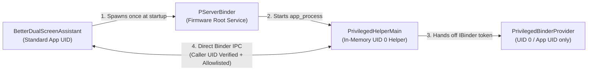

# Security & Privacy Overview

This document addresses common security, privacy, and hardware-safety questions about **Better Dual Screen Assistant** (`com.stormpanda.betterdualscreenassistant`) and explains how its security posture compares to the built-in stock `DualScreenAssistant` (`com.odin.dualscreen.assistant` on **AYN Thor** and `com.retroidpocket.dualscreen.assistant` on **Retroid Pocket Duo**).

---

## 1. Key Takeaways (TL;DR)

- **Zero Telemetry & Opt-Outable GitHub Update Checks Only**: Unlike the stock `DualScreenAssistant`—which requests `ACCESS_FINE_LOCATION`, `CAMERA`, `CALL_PHONE`, `READ_PHONE_STATE`, and `REQUEST_INSTALL_PACKAGES`—**Better Dual Screen Assistant** collects **zero analytics, telemetry, or personal data**. Its `android.permission.INTERNET` permission is used solely by `UpdateManager` to check `https://api.github.com/repos/stormpanda/better-dual-screen-assistant/releases/latest` for new releases (which can be disabled at any time in **Settings -> Updates -> Automatic Update Checks**), and the `UID 0` `PrivilegedHelperMain` daemon opens **zero network sockets**.
- **No Root / Bootloader Unlock Required**: The app installs as a standard user APK. To control dual-screen hardware (per-display brightness, backlight/OLED blanking, touch lock, fan speeds, and sysfs thermal sensors), it uses the same built-in firmware service (`PServerBinder`) that the stock `DualScreenAssistant` uses, without modifying `/system` or `/vendor`.
- **Smaller Attack Surface Than Stock**: The stock `DualScreenAssistant` runs permanently as `android.uid.system` (`UID 1000`) and (on AYN Thor) bundles a third-party library (`com.tamsiree.rxui`) with an exported `ActivityWebView` (`android:exported="true"`). **Better Dual Screen Assistant** contains zero ad/analytics SDKs, zero WebViews, and protects all of its services, broadcast receivers, and Binder interfaces against access by other installed apps (even rejecting `UID 1000` on its private Binder IPC).
- **Zero Risk of Permanent Screen Lockout or Broken Stock App**: The stock `DualScreenAssistant` is paused **ephemerally in RAM** (`SIGSTOP`) rather than left disabled on disk. While active, `PrivilegedHelperMain` supervises and respawns `AssistantForegroundService` across task clears or `force-stop`; if you ever **uninstall**, `pm disable`, or opt out of **Replace Stock Assistant**—even while one screen is turned off or touch-locked—the watchdog immediately unblanks both displays (including kernel `bl_power` on Retroid Pocket Duo), restores touch input (`sys.temp.disabled.touch = "0,0"`), removes any injected OS theme overlays, and wakes the stock `DualScreenAssistant`.
- **100% Source-Available & Auditable**: Every line of Kotlin code, Binder transaction, and shell command in this repository can be inspected, built from source for personal use, or verified against release SHA-256 checksums.

---

## 2. Comparison: Stock `DualScreenAssistant` vs. `BetterDualScreenAssistant`

The table below compares the built-in `/system/app/DualScreenAssistant/DualScreenAssistant.apk` shipped on the AYN Thor / Retroid Pocket Duo firmware against **Better Dual Screen Assistant**:

| Security & Privacy Factor | Stock `DualScreenAssistant` (`com.odin.*` / `com.retroidpocket.*`) | `BetterDualScreenAssistant` (`com.stormpanda.betterdualscreenassistant`) |
| :--- | :--- | :--- |
| **Source Code Availability** | Closed-source proprietary APK pre-installed in `/system/app` | **Source-Available** (Kotlin / Jetpack Compose) under `LICENSE` with reproducible builds |
| **Internet / Network Access** | Requests `android.permission.INTERNET` | Requests `INTERNET` **solely** for optional GitHub Releases update checks (`api.github.com`, toggleable in Settings; zero telemetry; `UID 0` helper has zero network code) |
| **Location, Camera & Phone Permissions** | Requests `ACCESS_FINE_LOCATION`, `ACCESS_COARSE_LOCATION`, `CAMERA`, `CALL_PHONE`, `READ_PHONE_STATE` | **None** (requests zero location, camera, microphone, or telephony permissions) |
| **Package Install Permission** | Requests `REQUEST_INSTALL_PACKAGES` | **None** |
| **Bundled WebViews / 3rd-Party SDKs** | Bundles `RxTool` (`com.tamsiree.rxui`) with an exported `ActivityWebView` (`exported="true"`) running as `UID 1000` | **None** (zero WebViews, zero analytics/crash-reporting SDKs) |
| **Privileged Hardware Access Mechanism** | Runs as `android.uid.system` (`UID 1000`) + invokes firmware `PServerBinder` (`UID 0` root shell) | Runs as a standard app UID + communicates with an authenticated in-memory `PrivilegedHelperMain` (`UID 0`) daemon spawned via `PServerBinder` |
| **FPS & Telemetry Polling Overhead** | Spawns a new root `/system/bin/sh` process (`service call SurfaceFlinger 1013`) via `PServerBinder` **every 1 second** while Settings is open | Uses direct in-memory Binder transactions (`TRANSACTION_GET_SF_FLIPS`, `TRANSACTION_READ_FILE`) with sub-millisecond latency and zero shell spawning |
| **Caller Authentication on IPC** | Relies on `PServerBinder` without caller UID validation | Enforces strict `Binder.getCallingUid()` verification (`UID 0` or BDSA's own app UID only) on `PrivilegedHelperMain` and `PrivilegedBinderProvider` |
| **File & Property Access Scope** | Unrestricted root shell execution | `HelperBinder` restricts file reads strictly to canonical `/sys/` & `/proc/stat` telemetry nodes (rejecting symlinks) and restricts property writes strictly to `sys.temp.disabled.touch` |
| **Protection Against Other Installed Apps** | Exports `MainActivity` and `ActivityWebView` without permission checks | Protects `AssistantForegroundService`, `TccKeyReceiver`, `BootReceiver`, and `dualScreenVolumeKeyReceiver` with `android.permission.DUMP` and `PrivilegedBinderProvider` with `INTERNAL_SYSTEM_WINDOW` + UID check |
| **Application Backup Exposure** | `android:allowBackup="true"` | `android:allowBackup="false"` (prevents ADB backup extraction or state injection) |
| **Uninstall & Recovery Safety** | Pre-installed persistent system app (`android:persistent="true"`) | Ephemerally pauses stock app in RAM; automatic watchdog restores screens, `bl_power`, touch, and stock assistant upon uninstall, package disable, or opt-out |

---

## 3. Why Privileged Access Is Needed (and How It Works)

Because **Better Dual Screen Assistant** is a full replacement for a hardware control system app, it must perform operations that normal Android APIs restrict to system processes:

1. **Independent Per-Display Brightness & Blanking**: Android's public `Settings.System.SCREEN_BRIGHTNESS` only controls the primary display (`displayId = 0`). Controlling the bottom screen (`displayId = 4` on AYN Thor / `displayId = 2` on Retroid Pocket Duo) and blanking individual panels (`IDisplayManager.setBrightness(displayId, -1.0f)` on AYN Thor or `/sys/class/backlight/panel{0,1}-backlight/bl_power` on Retroid Pocket Duo) requires privileged system access.
2. **Per-Screen Touch Controller Disabling**: Turning off touch input on a blanked screen (or activating the *Bottom Touch Lock* quick tile) requires setting the vendor system property `sys.temp.disabled.touch` (`"0,0"`, `"0,1"`, or `"1,0"`).
3. **Hardware Telemetry**: Reading real-time SoC temperature (`/sys/class/thermal/thermal_zone*/temp`), CPU/GPU clock speeds, battery power draw (`W`), and `SurfaceFlinger` page-flip / task FPS telemetry requires read access to kernel `/sys/` nodes and system Binder services.
4. **System-Wide Monet Theme Injection**: Applying custom Material You color palettes to Android SystemUI requires registering `FabricatedOverlay` packages with `IOverlayManager`.

### How `PServerBinder` and `PrivilegedHelperMain` Work Together

Both the AYN Thor and Retroid Pocket Duo stock firmwares include a built-in system service named `PServerBinder` (used by the stock `DualScreenAssistant` and `GameAssistant` apps to run privileged commands).

Rather than executing slow shell commands through `PServerBinder` on every UI interaction, **Better Dual Screen Assistant** uses a hardened 3-tier architecture (see [`PrivilegedBridge.kt`](../app/src/main/java/com/stormpanda/betterdualscreenassistant/privileged/PrivilegedBridge.kt) and [`PrivilegedHelperMain.kt`](../app/src/main/java/com/stormpanda/betterdualscreenassistant/privileged/PrivilegedHelperMain.kt)):



---

## 4. Defense-in-Depth Security Controls

Even though the underlying firmware exposes `PServerBinder` locally, **Better Dual Screen Assistant** applies strict defense-in-depth controls so that **no third-party app on your device can abuse our components or helper daemon**:

### 4.1 Caller UID Authentication (`PrivilegedHelperMain.kt`)
Every Binder transaction arriving at [`PrivilegedHelperMain.kt`](../app/src/main/java/com/stormpanda/betterdualscreenassistant/privileged/PrivilegedHelperMain.kt) (`HelperBinder.onTransact()`) is authenticated via `Binder.getCallingUid()`. The helper resolves the installed UID of `com.stormpanda.betterdualscreenassistant` from `IPackageManager` (invalidating its cached UID on client death) and immediately rejects (`SecurityException`) any call that does not originate from `UID 0` or `BetterDualScreenAssistant` itself (even `UID 1000` / `android.uid.system` is rejected).

### 4.2 Strict Capability Allowlists
Instead of exposing a generic "run arbitrary command" or "read arbitrary file" method over Binder, `HelperBinder` restricts its operations to the exact hardware controls required by the assistant:
- **Sysfs Telemetry Read Allowlist (`TRANSACTION_READ_FILE`)**: Only permits paths whose `canonicalPath` resides under `/sys/` or equals `/proc/stat`, rejecting `..` traversal and symlinks escaping `/sys/`. It cannot be used to read `/data/`, `/sdcard/`, or private app storage.
- **Sysfs Backlight Power Allowlist (`TRANSACTION_SET_BACKLIGHT_POWER`)**: Only accepts panel indices `0` or `1`, writing `"0"` or `"1"` exclusively to `/sys/class/backlight/panel{0,1}-backlight/bl_power` (Retroid Pocket Duo hardware blanking).
- **Window Session `addToDisplay` Allowlist (`TRANSACTION_WINDOW_SESSION_TRANSACT`)**: Proxies only `PRIVILEGED_OVERLAY_WINDOW_TYPE = 2021` (`TYPE_BOOT_PROGRESS`) overlay window attachment while keeping `MainActivity` and `TYPE_APPLICATION_OVERLAY` (`2038`) fallback windows on the standard app session; verifies `sessionBinder.interfaceDescriptor == "android.view.IWindowSession"`, enforces the `"android.view.IWindowSession"` parcel interface token, and fails closed unless `targetCode` matches a resolved `IWindowSession.Stub.TRANSACTION_addToDisplay*` code.
- **Media Output Path Validation (`TRANSACTION_CAPTURE_SCREENSHOT`, `TRANSACTION_START_SCREEN_RECORD`)**: Rejects `..` path traversal and symlinks, restricting canonical output files strictly to `/sdcard/Pictures/Screenshots/<name>.png` (or `/storage/emulated/0/Pictures/Screenshots/<name>.png`) and `.../Movies/ScreenRecordings/<name>.mp4`.
- **System Property Write Allowlist (`TRANSACTION_SET_SYSTEM_PROP`)**: Permits writing **only** `sys.temp.disabled.touch`. All other system properties (`persist.*`, `ctl.*`, `ro.*`) are rejected with `SecurityException`.
- **Package Name Validation**: Any package name passed to `TRANSACTION_FORCE_STOP_PACKAGE` (used by the *Clear Memory* speed-clean feature) is validated against a strict Android package identifier regex (`^[a-zA-Z][a-zA-Z0-9_]*(\.[a-zA-Z][a-zA-Z0-9_]*)+$`), and protected vendor/system packages (`com.android.systemui`, `com.stormpanda.betterdualscreenassistant`, `DeviceProfile.allProtectedVendorPackages`) are excluded from task swapping and memory cleaning.

### 4.3 Locked-Down Exported Android Components (`AndroidManifest.xml`)
In [`AndroidManifest.xml`](../app/src/main/AndroidManifest.xml):
- [`AssistantForegroundService`](../app/src/main/java/com/stormpanda/betterdualscreenassistant/service/AssistantForegroundService.kt), [`TccKeyReceiver`](../app/src/main/java/com/stormpanda/betterdualscreenassistant/receiver/TccKeyReceiver.kt), and [`BootReceiver`](../app/src/main/java/com/stormpanda/betterdualscreenassistant/receiver/BootReceiver.kt) (as well as the dynamic `dualScreenVolumeKeyReceiver` in [`SystemSettingsRepository.kt`](../app/src/main/java/com/stormpanda/betterdualscreenassistant/system/SystemSettingsRepository.kt)) require `android.permission.DUMP`—a privileged system permission held only by `system_server` (`UID 1000`), `root` (`UID 0`), and `adb shell` (`UID 2000`). Normal third-party apps cannot spoof physical button presses, spoof dual-screen volume events, toggle the overlay, or blank your displays.
- [`PrivilegedBinderProvider`](../app/src/main/java/com/stormpanda/betterdualscreenassistant/privileged/PrivilegedBinderProvider.kt) requires `android.permission.INTERNAL_SYSTEM_WINDOW` in the manifest and additionally enforces `callingUid == 0 || callingUid == Process.myUid()` in code.
- Dynamic broadcast receivers for standard volume, Wi-Fi, Bluetooth, and battery status in [`SystemSettingsRepository.kt`](../app/src/main/java/com/stormpanda/betterdualscreenassistant/system/SystemSettingsRepository.kt) and [`StatusBarRow.kt`](../app/src/main/java/com/stormpanda/betterdualscreenassistant/ui/statusbar/StatusBarRow.kt) are registered with `Context.RECEIVER_NOT_EXPORTED`.

### 4.4 Hardened Shell Fallbacks & Cross-App Sync
- **POSIX Single-Quote Escaping**: If `PrivilegedHelperMain` is ever restarting and `PrivilegedBridge` falls back to `PServerClient.exec()`, all dynamic arguments are wrapped with [`PServerClient.kt`](../app/src/main/java/com/stormpanda/betterdualscreenassistant/privileged/PServerClient.kt) (`PServerClient.shellQuote()`) to prevent shell token or command injection.
- **Verified `Megingiard` Theme Sync**: When syncing themes from the companion **Megingiard** app (`content://com.stormpanda.megingiard.provider/theme`), [`SystemSettingsRepository.kt`](../app/src/main/java/com/stormpanda/betterdualscreenassistant/system/SystemSettingsRepository.kt) (`isProviderAuthorityInstalled()`) verifies that the `ContentProvider` authority is owned by the authentic `com.stormpanda.megingiard` (or `.debug`) package, and `PrivilegedHelperMain` validates all theme JSON via `JSONObject` before writing to `Settings.Secure`.
- **Validated Update Release URLs**: [`UpdateManager.kt`](../app/src/main/java/com/stormpanda/megingiard/update/UpdateManager.kt) enforces `https://` and `github.com` host validation on `html_url` responses, bounds HTTP payloads to `256 KiB`, and applies offline failure backoff.

---

## 5. Permissions Breakdown & Privacy Guarantee

**Better Dual Screen Assistant** collects **zero personal data** and stores its user preferences locally in private app storage (`better_dsa_prefs` / Direct-Boot device-protected mirror with `android:allowBackup="false"`).

| Permission / AppOp | How It Is Granted | Why It Is Needed |
| :--- | :--- | :--- |
| `INTERNET` | Manifest | Used exclusively by `UpdateManager` to check GitHub Releases (`https://api.github.com/repos/stormpanda/better-dual-screen-assistant/releases/latest`) for app updates; can be disabled in **Settings -> Updates**; zero telemetry or analytics. |
| `SYSTEM_ALERT_WINDOW` | Manifest + `appops` | Fallback permission for bottom-screen overlay (`displayId = 4` / `2`) and screen-blanking dimmer windows. |
| `WRITE_SETTINGS` & `WRITE_SECURE_SETTINGS` | Manifest + `pm grant` | Updates system brightness, volume, dual-screen display mode (`dual_screen_display_mode`), performance mode, fan mode, controller style, and DND/location toggles. |
| `PACKAGE_USAGE_STATS` (`GET_USAGE_STATS`) | `appops` + `pm grant` | Inspects foreground app tasks when swapping apps between the top and bottom screens. |
| `FOREGROUND_SERVICE` & `FOREGROUND_SERVICE_SPECIAL_USE` | Manifest | Keeps `AssistantForegroundService` alive so the physical assistant button responds instantaneously at any time. |
| `RECEIVE_BOOT_COMPLETED` | Manifest | Automatically starts the assistant service and restores your preferred screen mode on device boot (including Direct Boot). |
| `ACCESS_WIFI_STATE` & `ACCESS_NETWORK_STATE` | Manifest | Displays the Wi-Fi signal strength icon in the overlay status bar and state of the Wi-Fi Quick Setting tile. |
| `BLUETOOTH` & `BLUETOOTH_CONNECT` | Manifest + `pm grant` | Displays the Bluetooth connection indicator in the overlay status bar and state of the Bluetooth Quick Setting tile. |
| `KILL_BACKGROUND_PROCESSES` | Manifest | Powers the **Clear Memory** quick tile and status bar clock tap-to-clean action. |
| `POST_NOTIFICATIONS` | Manifest + `pm grant` | Displays the required foreground service notification. |
| `QUERY_ALL_PACKAGES` | Manifest | Enumerates non-system background packages during **Clear Memory** so active launcher/system packages are never killed. |

---

## 6. Hardware Safety & Automatic Uninstall Recovery

A common concern when replacing a built-in hardware assistant is: *"What happens if I turn off one screen, lock touch input, or inject an OS theme, and then uninstall or disable the app?"*

### 6.1 Ephemeral Stock Suppression (Never Disabled on Disk)
The stock `DualScreenAssistant` (`com.odin.dualscreen.assistant` / `com.retroidpocket.dualscreen.assistant`) is marked `android:persistent="true"` in the firmware. If a tool permanently runs `pm disable` on the stock package and you later uninstall that tool, your physical assistant button stops working altogether.

To prevent this, [`PServerClient.kt`](../app/src/main/java/com/stormpanda/betterdualscreenassistant/privileged/PServerClient.kt) (`setStockAssistantEnabled(false)`) uses an **ephemeral in-memory pause**:
1. It briefly disables `TccServices`, restarts the stock process so its window unbinds cleanly, and sends `SIGSTOP` (`kill -STOP`) to freeze the windowless stock process in RAM.
2. It **immediately re-enables the stock package and `TccServices` on disk** while the process is frozen in RAM.
3. Because the stock app is never left disabled on disk, a simple reboot—or our automatic recovery watchdog—always leaves the stock assistant intact.

### 6.2 Persistent Service Supervisor & Automatic Uninstall Watchdog
[`PrivilegedHelperMain`](../app/src/main/java/com/stormpanda/betterdualscreenassistant/privileged/PrivilegedHelperMain.kt) links a Binder `DeathRecipient` (`linkToDeath`) to our app process. While **Better Dual Screen Assistant** remains installed and enabled and *Replace Stock Assistant* is active, it acts as a persistent service supervisor—clearing `ApplicationInfo.FLAG_STOPPED` and immediately respawning `AssistantForegroundService` across Recents task clears, RAM cleaners, and `force-stop` (guarded by a rapid-crash circuit breaker).

If **Better Dual Screen Assistant** is **uninstalled**, **package-disabled (`pm disable`)**, **opted out of *Replace Stock Assistant***, or trips the crash circuit breaker, `PrivilegedHelperMain` automatically executes `restoreDisplayAndStockAssistant()` before exiting:
1. Removes any top-screen blanking cover window and restores the status bar.
2. Restores both Top (`displayId = 0`) and Bottom (`displayId = 4` / `2`) screen brightness and unblanks kernel backlight power (`bl_power = 0` on Retroid Pocket Duo) if either screen was blanked.
3. Resets `dual_screen_display_mode = 0` (Dual-Screen mode) and re-enables touch input on both screens (`sys.temp.disabled.touch = "0,0"`).
4. Unregisters any injected Material You OS theme overlays and restores your original system theme and dark/light mode.
5. Wakes and restarts the stock `.services.TccServices` so the physical assistant button seamlessly reverts to stock behavior without requiring a reboot.

---

## 7. Verifying Release Integrity

Every official release of **Better Dual Screen Assistant** includes a companion `.sha256` checksum file (`BetterDualScreenAssistant-v<version>-checksum-sha256.txt`). You can verify any downloaded APK on macOS or Linux before installing:

```bash
shasum -a 256 -c BetterDualScreenAssistant-v<version>-checksum-sha256.txt
```

Or build and install the APK directly from this source repository yourself:

```bash
./scripts/debug.sh build-install
```
