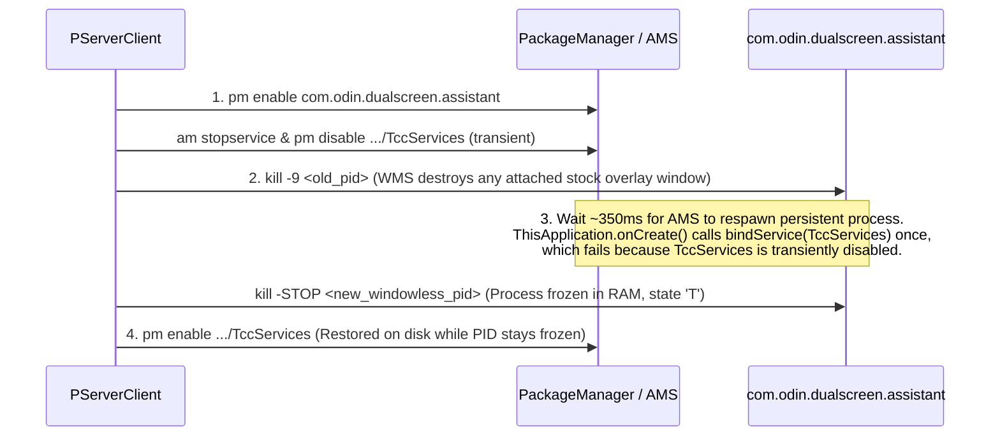

# Technical Architecture

This document details the internal architecture, privileged execution model, multi-display windowing invariants, stock process suppression mechanics, and state synchronization design of **Better Dual Screen Assistant** (`com.stormpanda.betterdualscreenassistant`).

---

## Table of Contents

1. [System Architecture Overview](#1-system-architecture-overview)
2. [Package & Source Code Organization](#2-package--source-code-organization)
3. [Three-Tier Privileged Execution Architecture](#3-three-tier-privileged-execution-architecture)
   - [3.1 Tier 1: `PServerBinder` Root Execution Service (`PServerClient`)](#31-tier-1-pserverbinder-root-execution-service-pserverclient)
   - [3.2 Tier 2: Persistent `UID 0` Root Binder Daemon (`PrivilegedHelperMain`)](#32-tier-2-persistent-uid-0-root-binder-daemon-privilegedhelpermain)
   - [3.3 Tier 3: In-Process Hidden API Bypass (`PrivilegedBridge`)](#33-tier-3-in-process-hidden-api-bypass-privilegedbridge)
   - [3.4 `IPrivilegedHelper` Binder Transaction Protocol (`v9`)](#34-iprivilegedhelper-binder-transaction-protocol-v9)
4. [Ephemeral Stock Suppression & Watchdog Recovery](#4-ephemeral-stock-suppression--watchdog-recovery)
   - [4.1 Why Standard Process Management Fails on `DualScreenAssistant`](#41-why-standard-process-management-fails-on-dualscreenassistant)
   - [4.2 The 4-Step Ephemeral Suppression Sequence](#42-the-4-step-ephemeral-suppression-sequence)
   - [4.3 Automatic Uninstall & Force-Stop Watchdog (`PrivilegedHelperMain`)](#43-automatic-uninstall--force-stop-watchdog-privilegedhelpermain)
5. [Multi-Display Windowing & Screen Blanking (`ScreenOverlayManager`)](#5-multi-display-windowing--screen-blanking-screenoverlaymanager)
   - [5.1 Display Topology & Context Isolation](#51-display-topology--context-isolation)
   - [5.2 Critical WindowManager Invariant: No `FLAG_LAYOUT_NO_LIMITS` on Display 4](#52-critical-windowmanager-invariant-no-flag_layout_no_limits-on-display-4)
   - [5.3 Custom Compose Lifecycle (`OverlayLifecycleOwner`) & Enter/Exit Animations](#53-custom-compose-lifecycle-overlaylifecycleowner--enterexit-animations)
   - [5.4 Screen Blanking Mechanics (Display 0 vs. Display 4)](#54-screen-blanking-mechanics-display-0-vs-display-4)
   - [5.5 Device Sleep / Wake Brightness Restoration](#55-device-sleep--wake-brightness-restoration)
6. [Reactive State Management (`SystemSettingsRepository`)](#6-reactive-state-management-systemsettingsrepository)
   - [6.1 ContentObservers & Broadcast Synchronization](#61-contentobservers--broadcast-synchronization)
   - [6.2 Brightness Drag Pipeline & Feedback-Loop Prevention](#62-brightness-drag-pipeline--feedback-loop-prevention)

---

## 1. System Architecture Overview

Because `BetterDualScreenAssistant` is distributed as a standard user-installable APK without the platform certificate or `android:sharedUserId="android.uid.system"`, it combines an in-process hidden API bridge with a persistent `UID 0` (`root`) Java Binder daemon (`PrivilegedHelperMain`) bootstrapped via the AYN Thor's firmware `PServerBinder` service.

```mermaid
flowchart TB
    subgraph UserProcess["App Process (com.stormpanda.betterdualscreenassistant - User UID)"]
        App["BetterDualScreenApp\n(HiddenApiBypass)"]
        Main["MainActivity\n(Display 0 Companion UI)"]
        Service["AssistantForegroundService\n(TCC Key State Machine)"]
        OverlayMgr["ScreenOverlayManager\n(Display 4 Compose Window & Blanking)"]
        Repo["SystemSettingsRepository\n(StateFlow + ContentObservers)"]
        Telemetry["TelemetryMonitor\n(1.5s Polling + SurfaceFlinger FPS)"]
        Vendor["VendorServices\n(FanProvider / IOverviewProxy / IMappingService)"]
        Bridge["PrivilegedBridge\n(3-Tier Privileged Router)"]
        Provider["PrivilegedBinderProvider\n(ContentProvider Handshake)"]
        PClient["PServerClient\n(PServerBinder Client)"]
    end

    subgraph RootProcess["Root Helper Daemon (PrivilegedHelperMain - UID 0 app_process)"]
        Helper["HelperBinder (v9)\n18 In-Memory Binder Transactions"]
        Watchdog["Client DeathRecipient & 250ms Watchdog\n(Uninstall / Force-Stop Recovery)"]
        TopBlank["Top Screen Blank Window\n(TYPE_BOOT_PROGRESS 2021 + StatusBar Disable)"]
    end

    subgraph AndroidOS["Android 13 Framework & AYN Hardware Services"]
        PServer["PServerBinder\n(Vendor Root Shell Service)"]
        SysServices["IDisplayManager / IWindowManager /\nIActivityTaskManager / IOverlayManager /\nIUiModeManager / SurfaceFlinger"]
        StockApp["Stock DualScreenAssistant\n(com.odin.dualscreen.assistant)"]
    end

    App --> Bridge
    Main --> Repo
    Service --> OverlayMgr
    Service --> Repo
    Service --> Vendor
    OverlayMgr --> Repo
    OverlayMgr --> Telemetry
    Repo --> Bridge
    Telemetry --> Bridge
    Bridge -->|Fast Path: In-Memory Binder IPC| Helper
    Bridge -->|Fallback: Shell IPC| PClient
    PClient -->|Transaction 0| PServer
    PServer -->|Spawns app_process| Helper
    PServer -->|Ephemeral SIGSTOP/SIGKILL| StockApp
    Helper -->|Registers IBinder via call()| Provider
    Provider --> Bridge
    Helper --> SysServices
    Helper --> TopBlank
    Watchdog -.->|Monitors Process & Package State| UserProcess
    Watchdog -.->|Restores Display/Touch & Wakes on Uninstall| StockApp
```

---

## 2. Package & Source Code Organization

The single `:app` Gradle module contains two logical Kotlin package trees under `app/src/main/java/`:

### 2.1 Core Application (`com.stormpanda.betterdualscreenassistant`)

| Package / File | Responsibility |
| :--- | :--- |
| [`BetterDualScreenApp.kt`](file:///Users/maikthomalla/Development/better-dual-screen-assistant/app/src/main/java/com/stormpanda/betterdualscreenassistant/BetterDualScreenApp.kt) | `Application` subclass. Unlocks hidden Android APIs via `HiddenApiBypass.addHiddenApiExemptions("")` in `attachBaseContext()`, initializes `PrivilegedBridge`, self-grants permissions via `PServerClient`, applies ephemeral stock assistant suppression, and starts `AssistantForegroundService`. |
| [`MainActivity.kt`](file:///Users/maikthomalla/Development/better-dual-screen-assistant/app/src/main/java/com/stormpanda/betterdualscreenassistant/MainActivity.kt) | Top-screen companion settings activity built with `GamepadTwoPaneScaffold`. Hosts the General, Quick Toggles (with visual `2×4` tile reordering), Appearance, and Diagnostics categories, and coordinates live previewing on Display 4. |
| [`service/AssistantForegroundService.kt`](file:///Users/maikthomalla/Development/better-dual-screen-assistant/app/src/main/java/com/stormpanda/betterdualscreenassistant/service/AssistantForegroundService.kt) | Persistent `specialUse` foreground service. Owns `SystemSettingsRepository`, `ScreenOverlayManager`, `TelemetryMonitor`, and `MappingServiceClient`, and executes the 3-state physical AYN button state machine. |
| [`overlay/ScreenOverlayManager.kt`](file:///Users/maikthomalla/Development/better-dual-screen-assistant/app/src/main/java/com/stormpanda/betterdualscreenassistant/overlay/ScreenOverlayManager.kt) | Manages the `TYPE_APPLICATION_OVERLAY` Compose window on `displayId = 4`, custom `OverlayLifecycleOwner`, `200ms` slide/fade animations, Display 0 and Display 4 blanking overlays, touch lock coordination, and screenshot capture. |
| [`privileged/PServerClient.kt`](file:///Users/maikthomalla/Development/better-dual-screen-assistant/app/src/main/java/com/stormpanda/betterdualscreenassistant/privileged/PServerClient.kt) | Direct Binder client for the firmware `PServerBinder` root execution service (`transaction 0`), permission self-granting, and the 4-step ephemeral stock assistant suppression sequence. |
| [`privileged/PrivilegedBridge.kt`](file:///Users/maikthomalla/Development/better-dual-screen-assistant/app/src/main/java/com/stormpanda/betterdualscreenassistant/privileged/PrivilegedBridge.kt) | Client-side router for privileged operations. Spawns and binds to `PrivilegedHelperMain`, falling back to reflective hidden API calls or `PServerClient.exec()` when needed. |
| [`privileged/PrivilegedHelperMain.kt`](file:///Users/maikthomalla/Development/better-dual-screen-assistant/app/src/main/java/com/stormpanda/betterdualscreenassistant/privileged/PrivilegedHelperMain.kt) | Standalone Java entry point (`main(Array<String>)`) executed as `UID 0` via `/system/bin/app_process`. Hosts `HelperBinder` (`v9`), the top-screen blanking cover window, OS `FabricatedOverlay` theme injection, and the uninstall/force-stop recovery watchdog. |
| [`privileged/PrivilegedBinderProvider.kt`](file:///Users/maikthomalla/Development/better-dual-screen-assistant/app/src/main/java/com/stormpanda/betterdualscreenassistant/privileged/PrivilegedBinderProvider.kt) | Unexported `ContentProvider` (`content://com.stormpanda.betterdualscreenassistant.privileged`) used exclusively as the IPC rendezvous point for `PrivilegedHelperMain` to deliver its `IBinder` token to the app process. |
| [`receiver/TccKeyReceiver.kt`](file:///Users/maikthomalla/Development/better-dual-screen-assistant/app/src/main/java/com/stormpanda/betterdualscreenassistant/receiver/TccKeyReceiver.kt) | Manifest receiver for `action.tcc.button.key.event` and `com.ro.external.request.light.adj.action`. Delegates directly to `AssistantForegroundService.instance` if running, or starts the service with intent extras. |
| [`receiver/BootReceiver.kt`](file:///Users/maikthomalla/Development/better-dual-screen-assistant/app/src/main/java/com/stormpanda/betterdualscreenassistant/receiver/BootReceiver.kt) | Starts `AssistantForegroundService` on `LOCKED_BOOT_COMPLETED`, `BOOT_COMPLETED`, and `MY_PACKAGE_REPLACED`. |
| [`system/SystemSettingsRepository.kt`](file:///Users/maikthomalla/Development/better-dual-screen-assistant/app/src/main/java/com/stormpanda/betterdualscreenassistant/system/SystemSettingsRepository.kt) | Central reactive repository (`StateFlow<AssistantUiState>`) synchronizing `Settings.System`, `Settings.Global`, `Settings.Secure`, `SharedPreferences`, `AudioManager`, `DisplayManager`, `WifiManager`, `BluetoothAdapter`, and `ContentProvider` theme state. |
| [`system/QuickSettingTileId.kt`](file:///Users/maikthomalla/Development/better-dual-screen-assistant/app/src/main/java/com/stormpanda/betterdualscreenassistant/system/QuickSettingTileId.kt) | Enumerates all 22 Quick Setting tiles, their categories (`STOCK`, `ANDROID_SYSTEM`, `TOOLS`), default visibility, and serialization helpers. |
| [`system/VendorServices.kt`](file:///Users/maikthomalla/Development/better-dual-screen-assistant/app/src/main/java/com/stormpanda/betterdualscreenassistant/system/VendorServices.kt) | Binder clients for AYN vendor services: `FanControlClient` (`SettingsController` -> `FanProvider`), `OverviewProxyClient` (`QUICKSTEP_SERVICE`), and `MappingServiceClient` (`MAPPING_SERVICE`). |
| [`system/TelemetryMonitor.kt`](file:///Users/maikthomalla/Development/better-dual-screen-assistant/app/src/main/java/com/stormpanda/betterdualscreenassistant/system/TelemetryMonitor.kt) | Polls CPU frequency, GPU frequency, thermal zone temperature, fan speed, battery power draw, RAM usage, and `SurfaceFlinger` FPS. |
| [`ui/overlay/AssistantOverlayScreen.kt`](file:///Users/maikthomalla/Development/better-dual-screen-assistant/app/src/main/java/com/stormpanda/betterdualscreenassistant/ui/overlay/AssistantOverlayScreen.kt) | Root Compose UI for the bottom-screen overlay (`Mode` tab, `Settings` tab, Quick Settings pager, modal dialogs, and `CloseScreenTipOverlay`). |
| [`ui/components/TccWidgets.kt`](file:///Users/maikthomalla/Development/better-dual-screen-assistant/app/src/main/java/com/stormpanda/betterdualscreenassistant/ui/components/TccWidgets.kt) | Custom non-Material canvas and touch widgets (`VerticalProgressBar`, `TccSliderRow`, `TccButton`, `CurrentFrameRateDisplay`, `HardwareRingGauge`, `TelemetryStatCard`, `TccPanelCard`). |
| [`ui/statusbar/StatusBarRow.kt`](file:///Users/maikthomalla/Development/better-dual-screen-assistant/app/src/main/java/com/stormpanda/betterdualscreenassistant/ui/statusbar/StatusBarRow.kt) | Top status bar composable (clock with one-tap memory clean, Bluetooth status, `TrafficStats` network speed, Wi-Fi bars, custom `BatteryIconCanvas`). |
| [`ui/theme/TccTheme.kt`](file:///Users/maikthomalla/Development/better-dual-screen-assistant/app/src/main/java/com/stormpanda/betterdualscreenassistant/ui/theme/TccTheme.kt) | Defines all 12 `AppThemeOption` values, `TccThemeColors` token sets for Stock Light/Dark and Megingiard palettes, and dynamic tint modifiers. |

### 2.2 Embedded Megingiard Design System (`com.stormpanda.megingiard`)

| Package / File | Responsibility |
| :--- | :--- |
| [`ui/GamepadScaffold.kt`](file:///Users/maikthomalla/Development/better-dual-screen-assistant/app/src/main/java/com/stormpanda/megingiard/ui/GamepadScaffold.kt) | `GamepadTwoPaneScaffold` and `GamepadDeck` providing two-pane controller navigation, breadcrumb headers, focus auto-scrolling, and `L1`/`R1` category switching. |
| [`ui/GamepadCards.kt`](file:///Users/maikthomalla/Development/better-dual-screen-assistant/app/src/main/java/com/stormpanda/megingiard/ui/GamepadCards.kt) | Focus-aware settings card primitives (`GamepadCard`, `GamepadSwitchCard`, `GamepadTwoStepConfirmCard`, `GamepadOptionCard`, `GamepadSectionHeader`, `GamepadStatusBadge`). |
| [`ui/GamepadFormInputs.kt`](file:///Users/maikthomalla/Development/better-dual-screen-assistant/app/src/main/java/com/stormpanda/megingiard/ui/GamepadFormInputs.kt) | Controller-navigable sliders (`GamepadSliderCard`), cycle selectors (`GamepadCycleCard`), and horizontal option pills (`GamepadHorizontalOptionSelector`). |
| [`ui/PrimaryOverlayInputBridge.kt`](file:///Users/maikthomalla/Development/better-dual-screen-assistant/app/src/main/java/com/stormpanda/megingiard/ui/PrimaryOverlayInputBridge.kt) | Hardware gamepad key & analog joystick event interceptor (`320ms` repeat delay, `95ms` repeat interval, `0.5f` stick deadzone, `L2` fine-step trigger detection). |
| [`ui/AppTheme.kt`](file:///Users/maikthomalla/Development/better-dual-screen-assistant/app/src/main/java/com/stormpanda/megingiard/ui/AppTheme.kt) & [`ui/AppPalettes.kt`](file:///Users/maikthomalla/Development/better-dual-screen-assistant/app/src/main/java/com/stormpanda/megingiard/ui/AppPalettes.kt) | Material 3 `ColorScheme` builders, 8 Megingiard color palettes, and 10 accent color presets. |
| [`settings/ThemeMode.kt`](file:///Users/maikthomalla/Development/better-dual-screen-assistant/app/src/main/java/com/stormpanda/megingiard/settings/ThemeMode.kt) | Shared `ThemeMode` enum (`DARK`, `DARK_OLED`, `LIGHT`, `SYSTEM`, `MJOLNIR`, `VALHALLA`, `AURORA`, `RETRO_PHOSPHOR`, `ROYAL_ASGARD`). |

---

## 3. Three-Tier Privileged Execution Architecture

### 3.1 Tier 1: `PServerBinder` Root Execution Service (`PServerClient`)

The AYN Thor firmware registers a system-level Binder service named `"PServerBinder"` inside Android's `ServiceManager`. [`PServerClient`](file:///Users/maikthomalla/Development/better-dual-screen-assistant/app/src/main/java/com/stormpanda/betterdualscreenassistant/privileged/PServerClient.kt) communicates with it directly:

- **Service Lookup**: `ServiceManager.getService("PServerBinder")`
- **Transaction Code**: `0` (`IBinder.FIRST_CALL_TRANSACTION - 1`)
- **Request Parcel**: `data.writeStringArray(arrayOf(command, if (wait) "1" else "0"))`
- **Reply Parcel**: `reply.createByteArray()` (UTF-8 stdout bytes when `wait == true`)

On app startup (`BetterDualScreenApp.onCreate()`), `PServerClient.ensurePermissionsGranted()` executes a single batched shell script that grants our package all required privileged appops and runtime permissions:
- `appops set <pkg> SYSTEM_ALERT_WINDOW allow`
- `appops set <pkg> WRITE_SETTINGS allow`
- `appops set <pkg> GET_USAGE_STATS allow`
- `pm grant <pkg> android.permission.WRITE_SECURE_SETTINGS`
- `pm grant <pkg> android.permission.PACKAGE_USAGE_STATS`
- `pm grant <pkg> android.permission.BLUETOOTH_CONNECT`
- `dumpsys deviceidle whitelist +<pkg>`

### 3.2 Tier 2: Persistent `UID 0` Root Binder Daemon (`PrivilegedHelperMain`)

While `PServerBinder` can run arbitrary root commands, spawning `/system/bin/sh` for every brightness drag step or telemetry read would incur `15–40ms` of fork/exec overhead. To achieve sub-millisecond (`< 0.2ms`) system-level calls, [`PrivilegedBridge`](file:///Users/maikthomalla/Development/better-dual-screen-assistant/app/src/main/java/com/stormpanda/betterdualscreenassistant/privileged/PrivilegedBridge.kt) spawns [`PrivilegedHelperMain`](file:///Users/maikthomalla/Development/better-dual-screen-assistant/app/src/main/java/com/stormpanda/betterdualscreenassistant/privileged/PrivilegedHelperMain.kt) as a long-lived `UID 0` Java process:

```sh
CLASSPATH=<applicationInfo.sourceDir> /system/bin/app_process /system/bin \
  com.stormpanda.betterdualscreenassistant.privileged.PrivilegedHelperMain >/dev/null 2>&1 &
```

**Binder Handshake Sequence**:
1. `PrivilegedHelperMain.main()` initializes `Looper.prepareMainLooper()` and instantiates `HelperBinder`.
2. It acquires `IActivityManager` and calls `getContentProviderExternal("com.stormpanda.betterdualscreenassistant.privileged", 0, token, "*privileged*")`.
3. It invokes `ContentProvider.call("register_binder", null, Bundle("binder" -> HelperBinder))` on [`PrivilegedBinderProvider`](file:///Users/maikthomalla/Development/better-dual-screen-assistant/app/src/main/java/com/stormpanda/betterdualscreenassistant/privileged/PrivilegedBinderProvider.kt).
4. `PrivilegedBinderProvider` passes the `IBinder` directly to `PrivilegedBridge.onHelperBinderReceived(binder)`.
5. `PrivilegedBridge` verifies `TRANSACTION_GET_VERSION == 9` (`HELPER_PROTOCOL_VERSION`) and sends its own `clientToken = Binder()` back via `TRANSACTION_REGISTER_CLIENT` (`13`) so the root helper can monitor the app process via `linkToDeath`.

### 3.3 Tier 3: In-Process Hidden API Bypass (`PrivilegedBridge`)

In `BetterDualScreenApp.attachBaseContext()`, `HiddenApiBypass.addHiddenApiExemptions("")` unlocks reflective access to hidden Android 13 framework methods within the app process itself (`DisplayManager.setBrightness`, `DisplayManager.setTemporaryBrightness`, `Display.getBrightnessInfo`, `SystemProperties.get`, `ServiceManager.getService`). If `PrivilegedHelperMain` is ever mid-reconnect, `PrivilegedBridge` transparently falls back to these reflective methods or `PServerClient.exec()`.

### 3.4 `IPrivilegedHelper` Binder Transaction Protocol (`v9`)

Descriptor: `"com.stormpanda.betterdualscreenassistant.IPrivilegedHelper"`

| Code (`FIRST_CALL_TRANSACTION + N`) | Constant Name | Request Parcel | Reply Parcel | Underlying Framework API Called as `UID 0` |
| :---: | :--- | :--- | :--- | :--- |
| `+0` | `TRANSACTION_PING` | *(none)* | `int (1)` | Health check |
| `+1` | `TRANSACTION_SET_BRIGHTNESS` | `displayId: Int`, `brightness: Float`, `temporary: Boolean` | `boolean` | `IDisplayManager.setTemporaryBrightness` / `setBrightness` |
| `+2` | `TRANSACTION_GET_BRIGHTNESS` | `displayId: Int` | `float` | `IDisplayManager.getBrightnessInfo` / `getBrightness` |
| `+3` | `TRANSACTION_PUT_SETTING` | `table: Int (0=Sys, 1=Global, 2=Secure)`, `key: String`, `value: String` | `boolean` | `Settings.{System,Global,Secure}.putString` |
| `+4` | `TRANSACTION_GET_SYS_PROP` | `key: String`, `def: String` | `String` | `android.os.SystemProperties.get(key, def)` |
| `+5` | `TRANSACTION_SET_SYS_PROP` | `key: String`, `val: String` | `boolean` | `android.os.SystemProperties.set(key, val)` |
| `+6` | `TRANSACTION_READ_FILE_TEXT` | `path: String` | `String?` | Direct `FileInputStream` read (used for `/sys/...` telemetry nodes) |
| `+7` | `TRANSACTION_GET_SF_PAGE_FLIPS` | *(none)* | `long[2] (flips, nanoTime)` | `ServiceManager.getService("SurfaceFlinger").transact(1013)` |
| `+8` | `TRANSACTION_CLEAN_MEMORY` | `callerPkg: String` | `int (killedCount)` | `IActivityManager.getRunningAppProcesses` + `killBackgroundProcesses` |
| `+9` | `TRANSACTION_SET_REFRESH_RATE` | `fps: Float` | `boolean` | Writes `min_refresh_rate` and `peak_refresh_rate` in `Settings.System` |
| `+10` | `TRANSACTION_BROADCAST` | `action: String`, `pkg: String?`, `boolKeys/Vals`, `intKeys/Vals` | `boolean` | `IActivityManager.broadcastIntentWithFeature` (`UID 0`) |
| `+11` | `TRANSACTION_SET_ROTATION_LOCK` | `locked: Boolean`, `rotation: Int` | `boolean` | `IWindowManager.freezeRotation(rotation)` / `thawRotation()` |
| `+12` | `TRANSACTION_REGISTER_CLIENT` | `clientToken: IBinder` | `boolean` | Registers `IBinder.DeathRecipient` for uninstall/force-stop recovery |
| `+13` | `TRANSACTION_GET_VERSION` | *(none)* | `int (9)` | Returns `HELPER_PROTOCOL_VERSION` (`9`) |
| `+14` | `TRANSACTION_GO_TO_SLEEP` | *(none)* | `boolean` | `IPowerManager.goToSleep(uptimeMillis, 0, 0)` |
| `+15` | `TRANSACTION_APPLY_OS_THEME` | `enabled: Boolean`, `isDark: Boolean`, `keys: String[]`, `colors: Int[]` | `boolean` | `FabricatedOverlay` + `IOverlayManager.commit` + `IUiModeManager.setNightMode` |
| `+16` | `TRANSACTION_SWAP_SCREENS` | *(none)* | `boolean` | `IActivityTaskManager.getAllRootTaskInfosOnDisplay(0/4)` + `moveRootTaskToDisplay` |
| `+17` | `TRANSACTION_SET_TOP_SCREEN_BLANKED` | `blanked: Boolean` | `boolean` | Attaches/removes `TYPE_BOOT_PROGRESS` (`2021`) black window on Display 0 + `IStatusBarService.disable` |

---

## 4. Ephemeral Stock Suppression & Watchdog Recovery

### 4.1 Why Standard Process Management Fails on `DualScreenAssistant`

The built-in system app `com.odin.dualscreen.assistant` (`/system/app/DualScreenAssistant/DualScreenAssistant.apk`) is declared in its manifest with `android:persistent="true"` and `android:sharedUserId="android.uid.system"`. This creates three critical hazards if handled naively:

1. **`am force-stop` is ignored**: `ActivityManagerService` ignores `force-stop` requests for `persistent="true"` system packages.
2. **Freezing (`kill -STOP`) while `TccServices` is bound freezes the stock window on screen**: If `SIGSTOP` is sent while `TccServices` has an attached overlay window, `WindowManagerService` never removes the window, permanently bricking touch and visuals on the bottom screen.
3. **Leaving `pm disable` on disk breaks uninstall**: If `com.odin.dualscreen.assistant` or `.services.TccServices` is left disabled in `PackageManager` on disk and the user uninstalls `BetterDualScreenAssistant`, the stock assistant remains permanently broken.

### 4.2 The 4-Step Ephemeral Suppression Sequence

Implemented in [`PServerClient.setStockAssistantEnabled(false)`](file:///Users/maikthomalla/Development/better-dual-screen-assistant/app/src/main/java/com/stormpanda/betterdualscreenassistant/privileged/PServerClient.kt#L68-L116), suppression is performed strictly in RAM while leaving the package enabled on disk:



To verify health at runtime (`PServerClient.isStockAssistantEnabled()`), the app inspects `/proc/<pid>/stat` for the stopped process state `) T ` in addition to querying `pm list packages -d`.

### 4.3 Persistent Service Supervisor & Automatic Uninstall Watchdog (`PrivilegedHelperMain`)

Because `PrivilegedHelperMain` runs independently under `UID 0`, it survives when our app process is killed by Recents task removal, Recents "Clear All", vendor RAM cleaners (`forceStopPackage`), OOM, updates, or uninstall. Meanwhile, `MainActivity` is marked `android:excludeFromRecents="true"` and calls `finishAndRemoveTask()` when navigating away so no persistent Settings card sits in Recents.

`PrivilegedHelperMain` monitors the app via two mechanisms:
1. **`IBinder.DeathRecipient` (`binderDied()`)** on the `clientToken` registered via `TRANSACTION_REGISTER_CLIENT`.
2. **Periodic Package Watchdog (`WATCHDOG_POLL_INTERVAL_MS = 250ms`)** checking `IPackageManager.getApplicationInfo`.

When the client process dies or disappears:
- **Uninstall or Package Disable Detection (`appInfo == null || !appInfo.enabled`)**: Triggers stock recovery immediately.
- **Opt-Out Respect (`!replaceStockPreferred`)**: If the user toggled off *Replace Stock Assistant* in Settings, does not force-respawn BDSA and cleans up helper state.
- **True Persistent Respawn (`replaceStockPreferred == true`)**: Clears `ApplicationInfo.FLAG_STOPPED` via `IPackageManager.setPackageStoppedState` and immediately restarts `AssistantForegroundService` (via direct `IActivityManager.startService` with `am start-foreground-service` fallback). If the same APK restarted, re-offers `HelperBinder` immediately; if `sourceDir` changed after an in-place APK update, allows the updated APK to spawn a fresh helper and exits cleanly.
- **Rapid-Crash Circuit Breaker (`MAX_RAPID_CRASHES = 8`, `MAX_UNREGISTERED_RESPAWN_ATTEMPTS = 6`)**: If the app repeatedly crashes within `3.0s` of startup or fails to register after `6` respawn attempts, triggers stock recovery rather than infinite-looping.

**Recovery Sequence (`restoreStockAssistantAndCleanup()`)**:
1. Removes any Display 0 blanking cover window and restores status bar flags (`IStatusBarService.disable(0)`).
2. Restores both Display 0 and Display 4 brightness if either was set to `< 0.01f` (blanked).
3. Resets `Settings.System["dual_screen_display_mode"] = 0` and `Settings.System["screen_focus_lock"] = 0`.
4. Resets `sys.temp.disabled.touch = "0,0"` so touch works on both displays.
5. Removes any injected OS `FabricatedOverlay` theme (`applyOsThemeInternal(false, ...)`).
6. Enables `com.odin.dualscreen.assistant` and `.services.TccServices`, sends `kill -9` to the frozen stock PID so AMS respawns it cleanly, and invokes `am startservice -n com.odin.dualscreen.assistant/.services.TccServices`.
7. Calls `exitProcess(0)` to terminate the root daemon cleanly.

---

## 5. Multi-Display Windowing & Screen Blanking (`ScreenOverlayManager`)

### 5.1 Display Topology & Context Isolation

- **Top Screen (`displayId = 0`)**: `1920 × 1080` (`369 dpi`).
- **Bottom Screen (`displayId = 4`)**: `1240 × 1080` (`369 dpi`, ~`840dp × 732dp`).

To attach an overlay window to the bottom display, [`ScreenOverlayManager`](file:///Users/maikthomalla/Development/better-dual-screen-assistant/app/src/main/java/com/stormpanda/betterdualscreenassistant/overlay/ScreenOverlayManager.kt) locates `Display` `4` via `DisplayManager.getDisplays()`, creates a display-bound context via `context.createDisplayContext(display4)`, and retrieves `WindowManager` from that display context.

### 5.2 Critical WindowManager Invariant: No `FLAG_LAYOUT_NO_LIMITS` on Display 4

When constructing `WindowManager.LayoutParams` for `displayId = 4`:
- Explicit pixel dimensions (`1240 × 1080` obtained via `display.getRealSize()`) and `Gravity.CENTER` are passed with `TYPE_APPLICATION_OVERLAY`.
- **`WindowManager.LayoutParams.FLAG_LAYOUT_NO_LIMITS` must NEVER be set on Display 4.** On the AYN Thor's Android 13 multi-display policy, setting `FLAG_LAYOUT_NO_LIMITS` on the secondary display causes `WindowManagerService` to lay out the surface at the primary display's width (`1920px`), clipping the rightmost `680px` of the overlay off the bottom screen.

### 5.3 Custom Compose Lifecycle (`OverlayLifecycleOwner`) & Enter/Exit Animations

Because `ComposeView` is attached directly to `WindowManager` outside an `Activity`, `ScreenOverlayManager` provides [`OverlayLifecycleOwner`](file:///Users/maikthomalla/Development/better-dual-screen-assistant/app/src/main/java/com/stormpanda/betterdualscreenassistant/overlay/ScreenOverlayManager.kt#L774-L811), implementing `LifecycleOwner`, `ViewModelStoreOwner`, and `SavedStateRegistryOwner` wired via `setViewTreeLifecycleOwner`, `setViewTreeViewModelStoreOwner`, and `setViewTreeSavedStateRegistryOwner`.

Furthermore, because `WindowManagerService` ignores custom app-resource `windowAnimations` (`R.style.tcc_anim`) on `TYPE_APPLICATION_OVERLAY` windows for non-system apps, `ScreenOverlayManager` animates `ComposeView` directly via `ViewPropertyAnimator`:
- **Show Animation (`200ms`, `DecelerateInterpolator`)**: Animates `alpha` from `0f -> 1f` and `translationY` from `height * 0.90f -> 0f`.
- **Hide Animation (`200ms`, `AccelerateInterpolator`)**: Animates `alpha` from `1f -> 0f` and `translationY` from `0f -> height * 0.90f`, calling `windowManager.removeViewImmediate()` only inside `withEndAction`.

### 5.4 Screen Blanking Mechanics (Display 0 vs. Display 4)

Turning off a display via `dual_screen_display_mode` (`1` = Only Top, `2` = Only Bottom) does not power down the MIPI panel at the HWC level (which would trigger an Android display removal/re-layout cascade). Instead, it uses a coordinated 4-part blanking sequence:

| Aspect | Mode 1: Blank Bottom Screen (`displayId = 4`) | Mode 2: Blank Top Screen (`displayId = 0`) |
| :--- | :--- | :--- |
| **Settings Key** | `Settings.System["dual_screen_display_mode"] = 1` | `Settings.System["dual_screen_display_mode"] = 2` |
| **Focus Lock** | Saves current `screen_focus_lock`, sets `screen_focus_lock = 1` (Top) | Saves current `screen_focus_lock`, sets `screen_focus_lock = 2` (Bottom) |
| **Touch Disable** | `sys.temp.disabled.touch = "0,1"` (Bottom touch disabled) | `sys.temp.disabled.touch = "1,0"` (Top touch disabled) |
| **Visual Cover Window** | `BlankOverlayView` (`TYPE_APPLICATION_OVERLAY`, `FLAG_NOT_FOCUSABLE \| FLAG_NOT_TOUCHABLE \| FLAG_LAYOUT_IN_SCREEN`) faded in over `200ms` on Display 4 | `PrivilegedHelperMain.setTopScreenBlanked(true)` attaches a black cover view with **`TYPE_BOOT_PROGRESS` (`2021`)** on Display 0 (sits above StatusBar, Keyguard, and NavigationBar) and calls `IStatusBarService.disable(DISABLE_EXPAND \| DISABLE_NOTIFICATION_ICONS \| DISABLE_NOTIFICATION_ALERTS \| DISABLE_SYSTEM_INFO \| DISABLE_CLOCK)` |
| **Backlight Shutdown** | Saves current Display 4 brightness, then calls `PrivilegedBridge.setDisplayBrightness(4, -1.0f)` | Saves current Display 0 brightness, then calls `PrivilegedBridge.setDisplayBrightness(0, -1.0f)` |

### 5.5 Device Sleep / Wake Brightness Restoration

If a display is blanked (`brightness = -1.0f`) when the user presses the physical Power button to put the device to sleep (`Intent.ACTION_SCREEN_OFF`), Android's power state machine could persist `-1.0f` across sleep/wake cycles. `ScreenOverlayManager`'s `screenPowerReceiver` handles this automatically:
- **On `ACTION_SCREEN_OFF`**: Immediately restores the saved pre-blank brightness (`savedTopBrightness` / `savedBottomBrightness`) to `DisplayManager` while the panel is powering off.
- **On `ACTION_SCREEN_ON`**: If `topScreenBlanked` or `bottomScreenBlanked` is still active, re-applies `setDisplayBrightness(displayId, -1.0f)` so the blanked screen remains dark upon wake.

---

## 6. Reactive State Management (`SystemSettingsRepository`)

[`SystemSettingsRepository`](file:///Users/maikthomalla/Development/better-dual-screen-assistant/app/src/main/java/com/stormpanda/betterdualscreenassistant/system/SystemSettingsRepository.kt) exposes a single immutable `StateFlow<AssistantUiState>` consumed by both `AssistantOverlayScreen` (Display 4) and `MainActivity` (Display 0).

### 6.1 ContentObservers & Broadcast Synchronization

The repository registers listeners across five system channels:
1. **`Settings.System` & `Settings.Global` `ContentObserver`s**: Watches all 20+ AYN and Android settings URIs (display mode, focus lock, brightness, secondary volume, performance mode, fan mode, controller style, charging separation, 80% charge limit, trigger mode, vibration, force landscape, DND, airplane mode, etc.).
2. **`Megingiard` Theme `ContentObserver`**: Watches `content://com.stormpanda.megingiard.provider/theme` and `content://com.stormpanda.megingiard.debug.provider/theme` (`notifyForDescendants = true`) for zero-latency cross-app theme synchronization.
3. **`SharedPreferences.OnSharedPreferenceChangeListener`**: Watches `better_dsa_prefs` for companion app settings and tile order changes.
4. **System BroadcastReceiver**: Listens for `android.media.VOLUME_CHANGED_ACTION`, `WifiManager.WIFI_STATE_CHANGED_ACTION`, `BluetoothAdapter.ACTION_STATE_CHANGED`, `NotificationManager.ACTION_INTERRUPTION_FILTER_CHANGED`, `Intent.ACTION_AIRPLANE_MODE_CHANGED`, `Intent.ACTION_CONFIGURATION_CHANGED`, and `com.ro.external.request.light.adj.action`.
5. **`DisplayManager.DisplayListener`**: Listens for `onDisplayChanged(displayId)` to detect live hardware brightness changes on Display 0 and Display 4.

### 6.2 Brightness Drag Pipeline & Feedback-Loop Prevention

When the user drags a brightness slider in the overlay (`setTopBrightness`, `setBottomBrightness`, `setDualBrightness`):
1. **Immediate Optimistic UI Update**: `_uiState.update` updates the slider value synchronously on the UI thread so the thumb tracks the user's finger with zero latency.
2. **Self-Write Grace Window (`250ms`)**: Records `lastTopBrightnessSelfUpdateMs` / `lastBottomBrightnessSelfUpdateMs`. Any asynchronous `ContentObserver` or `DisplayListener` callbacks arriving within `250ms` of a self-initiated write (`isInSelfBrightnessGraceWindow()`) are ignored so slightly delayed intermediate hardware values cannot cause slider jitter.
3. **Throttled Hardware Dispatch (`backgroundExecutor`)**: Dispatches `PrivilegedBridge.setDisplayBrightness(displayId, fraction, temporary = true)` on a single background thread while dragging (`temporary = false` + `Settings.System` commit on finger release).
4. **External SystemUI Brightness Drag Tracking**: When `onDisplayChanged(0)` fires outside the self-write grace window, `readHardwareDisplayBrightness255(0)` inspects `Display.getBrightnessInfo()` (`adjustedBrightness` / `brightness`) so dragging Android's top-screen SystemUI brightness slider updates the bottom-screen Assistant Overlay slider in real time.
